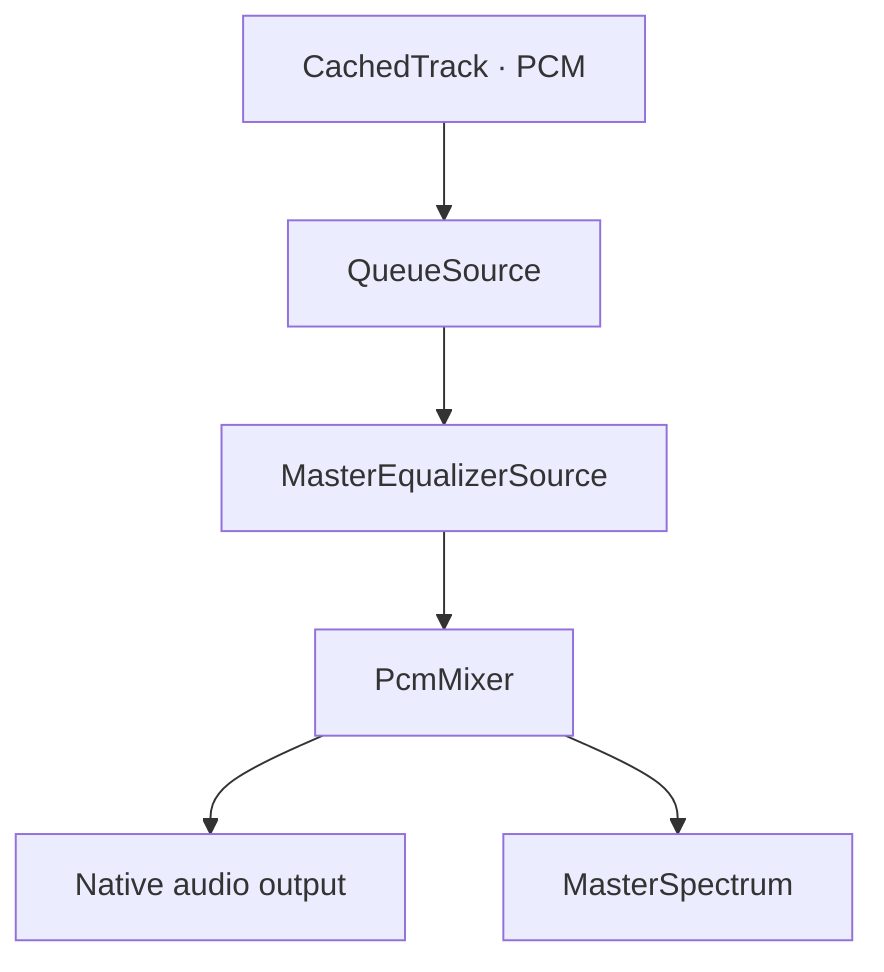

# LavPulse

English | [Русский](README.ru.md)

LavPulse is a local MP3 player with a two-deck DJ mixer, built with .NET 10 and .NET MAUI.

The application decodes tracks into a seekable PCM cache, mixes them on a shared 48 kHz stereo timeline, applies a configurable master equalizer, and displays waveforms and a spectrum of the resulting output. Windows, Android, and iOS have native audio and system-media integrations; the mixing and queue logic is shared.

## Contents

- [Build and run](#build-and-run)
- [Capabilities](#capabilities)
- [Architecture](#architecture)
- [Repository map](#repository-map)
- [Execution paths](#execution-paths)
- [Public API](#public-api)
- [Lifecycle and threading](#lifecycle-and-threading)
- [Checks](#checks)
- [Limitations](#limitations)
- [Extension points](#extension-points)
- [Dependencies and license](#dependencies-and-license)

## Build and run

Open [`Laveyana.Audio.Maui.slnx`](Laveyana.Audio.Maui.slnx) in Visual Studio with the **.NET 10 SDK** and the **.NET MAUI** workload. Android requires the Android SDK and JDK 21. Windows requires WinUI/MAUI tooling, and iOS requires a Mac, compatible Xcode, and the `maui-ios` workload.

| Target | Project | Command |
|---|---|---|
| Windows | `Laveyana.Audio.Maui.csproj` | `dotnet build samples/Laveyana.Audio.Maui/Laveyana.Audio.Maui.csproj -c Debug` |
| Android | `Laveyana.Audio.Maui.Android.csproj` | `dotnet build samples/Laveyana.Audio.Maui/Laveyana.Audio.Maui.Android.csproj -c Debug -p:AndroidPackageFormats=apk` |

On a Mac, build the iPhone simulator target as follows. The [iOS workflow](.github/workflows/ios.yml) pins a compatible SDK and Xcode. To build for an iPhone, select `ios-arm64` and configure Apple development signing.

```bash
dotnet workload install maui-ios
dotnet build samples/Laveyana.Audio.Maui/Laveyana.Audio.Maui.csproj -c Debug -p:LavPulsePlatform=ios -p:RuntimeIdentifier=iossimulator-arm64 -p:EnableCodeSigning=false
```

Before installing the simulator build with `simctl install`, locally sign the generated bundle with `codesign --force --deep --sign - path/to/Laveyana.Audio.Maui.app`.

Run `dotnet restore Laveyana.Audio.Maui.slnx` after switching platforms or updating workloads. The solution keeps Windows and Android intermediate outputs separate (see [`Directory.Build.props`](Directory.Build.props)) to prevent mixed NuGet assets and long Android resource paths.

In the app, import MP3 files or a folder from **Settings → Media library**; Windows also supports drag-and-drop. Select a track in the queue to start a transition without reordering the playlist. Tap the active **Queue** tab again to hide or show played tracks.

Use **▾** beside the deck speed for presets from **0.75× to 1.25×** in steps of **0.05×**. The field accepts manual input, and a Windows mouse wheel step changes speed by **0.01×**.

**Settings → Master spectrum → Frame rate (FPS)** sets a drawing limit for the spectrum. **Auto** follows the platform's frame clock. The presets are 30, 60, 90 and 120 FPS, with 144, 165, 240 and 360 FPS also available on Windows. Changes preview immediately. **Save** keeps the selection and **Cancel** restores it. The device controls the available refresh rate. Deck playheads keep using every available display tick, and the FFT retains its analysis interval.

Open an MP3 from the system file manager to play it in LavPulse. On Windows, launch LavPulse once from its installed location, then select it under **Settings → Apps → Default apps → .mp3**. On Android, choose LavPulse in the file chooser and tap **Always** when offered. On iPhone, select LavPulse in **Files → Open With**. On versions of Files that support a default per file type, set it in the MP3 file’s **Get Info** menu. On Mac, Finder’s **Get Info → Open with → Change All** sets the association for MP3.

## Capabilities

- Two decks with manually requested or automatic hyperbolic crossfades, transport fades, repeat-one and variable playback speed.
- Ten-band master EQ plus output gain, applied **before** master-spectrum analysis.
- Detailed and overview waveforms, seek gestures, a frequency spectrum and an animated deck handoff.
- Reorderable queue, played-track history, ID3 artwork/tags, and sequential background preparation of up to ten upcoming MP3s.
- Background playback and OS media commands on Android, Windows, and iOS.

## Architecture

The UI never decodes MP3 on the render thread. A prepared track owns a PCM cache file and waveform data. One output session combines the decks, applies the master EQ, and reports the audible timeline.



| Layer | Responsibility | Entry points |
|---|---|---|
| Core DSP | Stereo mixing, common PCM contract, frequency analysis | [`IPcmSource`](src/Laveyana.Audio/IPcmSource.cs), [`PcmMixer`](src/Laveyana.Audio/PcmMixer.cs), [`MasterSpectrum`](src/Laveyana.Audio/MasterSpectrum.cs) |
| Preparation and playback | Decode, caching, deck state, equalization, output abstraction | [`TrackPreparation`](src/Laveyana.Audio.Playback/Tracks/TrackPreparation.cs), [`QueuePlaybackSession`](src/Laveyana.Audio.Playback/Session/QueuePlaybackSession.cs), [`IAudioOutput`](src/Laveyana.Audio.Playback/Session/IAudioOutput.cs) |
| Application | Library, ordered queue, commands, platform lifetime | [`MainPage`](samples/Laveyana.Audio.Maui/MainPage.cs), [`PlayerLibrary`](samples/Laveyana.Audio.Maui/Tracks/PlayerLibrary.cs), [`PlaybackQueue`](samples/Laveyana.Audio.Maui/Tracks/PlaybackQueue.cs) |
| Views | C# MAUI controls and gestures | [`PlayerView`](src/Laveyana.Audio.Maui.Controls/Views/PlayerView.cs), [`DeckView`](src/Laveyana.Audio.Maui.Controls/Views/DeckView.cs), [`TrackQueueView`](src/Laveyana.Audio.Maui.Controls/Views/TrackQueueView.cs) |

<details>
<summary>Audio and queue internals</summary>

[`QueueSource`](src/Laveyana.Audio.Playback/Session/QueueSource.cs) owns the current and prepared next PCM readers, provides seek and speed control, and promotes the incoming deck when a transition finishes. A manual transition is requested before the next render block. [`MasterEqualizerSource`](src/Laveyana.Audio.Playback/Session/MasterEqualizerSource.cs) filters that **combined** signal using ten peaking bands and a gain stage; configuration changes crossfade between filter banks. [`MixedPlayback`](src/Laveyana.Audio.Playback/Session/MixedPlayback.cs) renders blocks and publishes FFT results with the native playback-head position where available.

[`PlayerLibrary`](samples/Laveyana.Audio.Maui/Tracks/PlayerLibrary.cs) limits concurrent decoders, deduplicates preparation tasks, and protects the occupied decks and up to ten upcoming tracks from cache eviction. The app prepares that window in queue order on a worker thread. A directly selected track can use another decoding slot. The ordered [`PlaybackQueue`](samples/Laveyana.Audio.Maui/Tracks/PlaybackQueue.cs) does not reorder itself when the user selects a different track: the current position defines which entries are displayed as played.

</details>

## Repository map

```text
src/Laveyana.Audio/                 PCM mixing and FFT
src/Laveyana.Audio.Playback/        MP3 preparation, cache, queue mixer, EQ
src/Laveyana.Audio.Maui.Controls/   C# player UI and platform gestures
samples/Laveyana.Audio.Maui/       MAUI host, media library, settings, output adapters
tests/Laveyana.Audio.Playback.Checks/  Executable regression checks
```

[`MainPage`](samples/Laveyana.Audio.Maui/MainPage.cs) owns the application's state and event bindings. Its workflows are split between `MainPage.Import.cs`, `MainPage.Queue.cs`, `MainPage.Analysis.cs`, `MainPage.Transport.cs`, `MainPage.Rendering.cs`, `MainPage.SystemPlayback.cs`, `MainPage.Dialogs.cs` and `MainPage.State.cs`. The queue's cover-card implementation lives in [`TrackQueueView.TrackCard.cs`](src/Laveyana.Audio.Maui.Controls/Views/TrackQueueView.TrackCard.cs).

## Execution paths

- **Import.** `MainPage.AddFilesAsync` adds entries through `PlayerLibrary.Add`. `LoadFirstAsync` prepares the first deck, and `TrackPreparation.ImportAsync` creates the PCM cache and waveform. `UpdateQueueAnalysis` gives upcoming files to `QueueTrackAnalysis`.
- **Track selection.** `ChooseAsync` requests a transition through `StartMixAsync`. `ArmAsync` prepares the selected track for the next deck. `QueuePlaybackSession.RequestMix` forwards the request to `QueueSource`.
- **Playback.** `QueuePlaybackSession.RunAsync` starts the native output, which pulls stereo PCM blocks through `MixedPlayback.Render` from the chain shown above.

Android tries the system MP3 decoder through `MediaExtractor` and `MediaCodec`. A non-seekable input is copied to a temporary MP3 first. If the system decoder cannot prepare the track, the importer retries from the beginning with NLayer. Both paths create the same seekable 48 kHz stereo PCM16 cache and waveform data format.

## Public API

The DSP and playback libraries have **no MAUI dependency**. External hosts supply an [`IAudioOutput`](src/Laveyana.Audio.Playback/Session/IAudioOutput.cs) implementation; the Android and Windows implementations in the sample host are internal.

```csharp
using Laveyana.Audio.Playback;

static async Task PlayFileAsync(
    string mp3Path, string cacheDirectory, IAudioOutput output,
    CancellationToken token)
{
    var preparation = new TrackPreparation(cacheDirectory);
    var track = await preparation.ImportAsync(TrackFile.FromPath(mp3Path), token);
    try
    {
        using var session = new QueuePlaybackSession();
        session.SetFirst(track);
        session.SetEqualizer(EqualizerSettings.Flat.WithEnabled(true).WithGain(0, 3));
        await session.RunAsync(output, token);
    }
    finally
    {
        track.Delete();
    }
}
```

[`PcmMixer`](src/Laveyana.Audio/PcmMixer.cs) can also mix independent `IPcmSource` inputs with shared sample rates, without a queue. The ten EQ frequencies are published in [`EqualizerSettings.Frequencies`](src/Laveyana.Audio.Playback/Session/EqualizerSettings.cs).

<details>
<summary>Playback integration contract</summary>

`IAudioOutput.PlayAsync(IAudioRenderSource, CancellationToken)` repeatedly requests interleaved stereo frames from `IAudioRenderSource.Render`. It must not call `Render` concurrently and should report device-consumed frames with `ReportOutputPosition` when supported. The current formats are centralized in [`PlaybackFormat`](src/Laveyana.Audio.Playback/Session/PlaybackFormat.cs): 48,000 Hz, two channels and 1,024-frame render blocks. The mixer and platform adapter contract use `float` samples. Cache files and Android/Windows output use PCM16. The Apple adapter supplies separate `float` buffers for each channel to AVAudioEngine. A `CachedTrack` owns its decoded PCM file; delete it only after all playback readers have finished.

For one-shot, independently controlled decks, [`PlaybackSession`](src/Laveyana.Audio.Playback/Session/PlaybackSession.cs) takes an output adapter, `DeckVolumes`, prepared tracks and starting cues. For playlist playback, `QueuePlaybackSession` keeps deck cursors across pause/resume and supports `SetNext`, `RequestMix`, `Seek`, `TrySetSpeed` and `RequestPause`.

</details>

## Lifecycle and threading

- `MainPage` owns `PlayerLibrary`, `PlaybackQueue`, `QueuePlaybackSession` and the OS media bridge; `CloseAsync` cancels/awaits playback and analysis before deleting cached audio.
- Imports and waveform analysis use async tasks with bounded decoding. The native output consumes PCM on its own thread; C# MAUI views and queue state are updated on the UI dispatcher.
- The audio mixer has one render caller. `QueueSource` synchronizes changes to the active/next deck; the latest display snapshot is read separately. The decoder-to-UI track lookup uses a concurrent dictionary.
- While minimized, track preparation continues independently of the visual refresh. Android uses a foreground service for batches started from the player. On iOS, background audio keeps preparation running during playback. While paused, iOS grants limited background time and unfinished work resumes when the player returns. On Windows, preparation continues while the window is minimized.
- Minimizing does not cancel the mixer. Android uses a media foreground service, Windows publishes System Media Transport Controls, and iOS uses AVAudioSession and Now Playing.

<details>
<summary>Performance and ownership details</summary>

The 256 MiB eviction threshold applies to decoded PCM. The cache can exceed it while keeping the active, selected, and upcoming tracks ready on disk. Preparation of a previously evicted track may take time. Queue rows are virtualized; full ID3 artwork is downscaled for thumbnails. Waveform geometry is cached separately from the playhead; the spectrum analyzer can be disabled when the master-spectrum UI is hidden.

The master mixer renders a single source straight into the output block, applies gain when needed, clamps the samples, and clears any unwritten frames. PCM16 reads at 1× speed and a whole-frame position use SIMD when hardware supports it. Other speeds and fractional positions keep the interpolating path.

The ID3 reader rents a temporary buffer and copies the selected cover once. Queue and deck image streams reuse array-backed cover bytes. Spectrum paint allocates a color for a brightness step on its first use and reuses it until the corresponding colors or mode change.

The platform adapters use AudioTrack, WaveOut and AVAudioEngine. [Android](samples/Laveyana.Audio.Maui/Platforms/Android/PlatformAudioOutput.cs) · [Windows](samples/Laveyana.Audio.Maui/Platforms/Windows/PlatformAudioOutput.cs) · [Apple](samples/Laveyana.Audio.Maui/Apple/PlatformAudioOutput.cs)

Android's [`AndroidMediaPlaybackService`](samples/Laveyana.Audio.Maui/Platforms/Android/AndroidMediaPlaybackService.cs) provides system controls, and [`WindowsMediaIdentity`](samples/Laveyana.Audio.Maui/Platforms/Windows/WindowsMediaIdentity.cs) registers the unpackaged desktop identity.

</details>

## Checks

[`Laveyana.Audio.Playback.Checks`](tests/Laveyana.Audio.Playback.Checks/Program.cs) is an executable console regression suite, **not** an xUnit/NUnit project:

```bash
dotnet run --project tests/Laveyana.Audio.Playback.Checks -c Release
```

It covers MP3 frame information, ID3 artwork selection, PCM16 reads, mixing and silence padding, spectrum capture, transport fades, seeking and speed, queue history, repeat-one, the master EQ, and output failure cleanup. Add deterministic audio invariants here; exercise native MAUI gestures, background playback and system media sessions on the corresponding devices. [`build.yml`](.github/workflows/build.yml) runs by manual dispatch.

Start the iOS check manually through **Actions → iPhone simulator → Run workflow**. Once the updated workflow is on `master`, the run menu lets you select a branch. The job builds and launches the app in an iPhone simulator. [iOS workflow configuration](.github/workflows/ios.yml)

For a manual iOS check, import two MP3s from Files, exercise mixing, EQ and seeking, then lock the screen and try the Now Playing controls.

## Limitations

- The import path accepts local **MP3**, not streaming services or arbitrary codecs. Decoding supports mono/stereo MP3 with a source rate up to 48 kHz.
- Changing deck speed resamples PCM and **changes pitch**; beat matching and pitch-preserving time stretching are not implemented here.
- The mixer provides two playback decks and one stereo master output. It does not enumerate or synchronize several simultaneous audio devices.
- Recommendations are a UI placeholder.
- Windows may show additional latency due to WaveOut buffering; system controls and background behavior depend on the OS and device.

## Extension points

| Task | Start here |
|---|---|
| Add a decoder or input source | [`IPcmSource`](src/Laveyana.Audio/IPcmSource.cs), [`TrackPreparation`](src/Laveyana.Audio.Playback/Tracks/TrackPreparation.cs) |
| Change crossfades, pause or deck speed | [`QueueSource`](src/Laveyana.Audio.Playback/Session/QueueSource.cs), [`TransportFadeSource`](src/Laveyana.Audio.Playback/Session/TransportFadeSource.cs) |
| Change EQ or frequency analysis | [`MasterEqualizerSource`](src/Laveyana.Audio.Playback/Session/MasterEqualizerSource.cs), [`MasterSpectrum`](src/Laveyana.Audio/MasterSpectrum.cs) |
| Change queue, history or background preparation | [`MainPage.Queue.cs`](samples/Laveyana.Audio.Maui/MainPage.Queue.cs), [`MainPage.Analysis.cs`](samples/Laveyana.Audio.Maui/MainPage.Analysis.cs), [`PlaybackQueue`](samples/Laveyana.Audio.Maui/Tracks/PlaybackQueue.cs) |
| Change gestures, waveforms or player layout | [`DeckView`](src/Laveyana.Audio.Maui.Controls/Views/DeckView.cs), [`TrackQueueView`](src/Laveyana.Audio.Maui.Controls/Views/TrackQueueView.cs), [`WaveformDrawable`](src/Laveyana.Audio.Maui.Controls/Views/WaveformDrawable.cs) |
| Add a native output or media integration | [`IAudioOutput`](src/Laveyana.Audio.Playback/Session/IAudioOutput.cs), [`SystemPlaybackIntegration`](samples/Laveyana.Audio.Maui/SystemPlaybackIntegration.cs) |

## Dependencies and license

LavPulse is licensed under [MIT](LICENSE). Main external dependencies are [NLayer 3.0.1](https://www.nuget.org/packages/NLayer/3.0.1) (MP3 decoding, MIT), [NAudio.WinMM 2.2.1](https://www.nuget.org/packages/NAudio.WinMM/2.2.1) (Windows WaveOut, MIT), and [Microsoft.Maui.Controls](https://github.com/dotnet/maui) (cross-platform UI, MIT). The bundled Inter font uses the SIL Open Font License, with its text at [`Inter-OFL.txt`](samples/Laveyana.Audio.Maui/Resources/Fonts/Inter-OFL.txt). Retain third-party copyright/license notices when redistributing dependencies or fonts.
