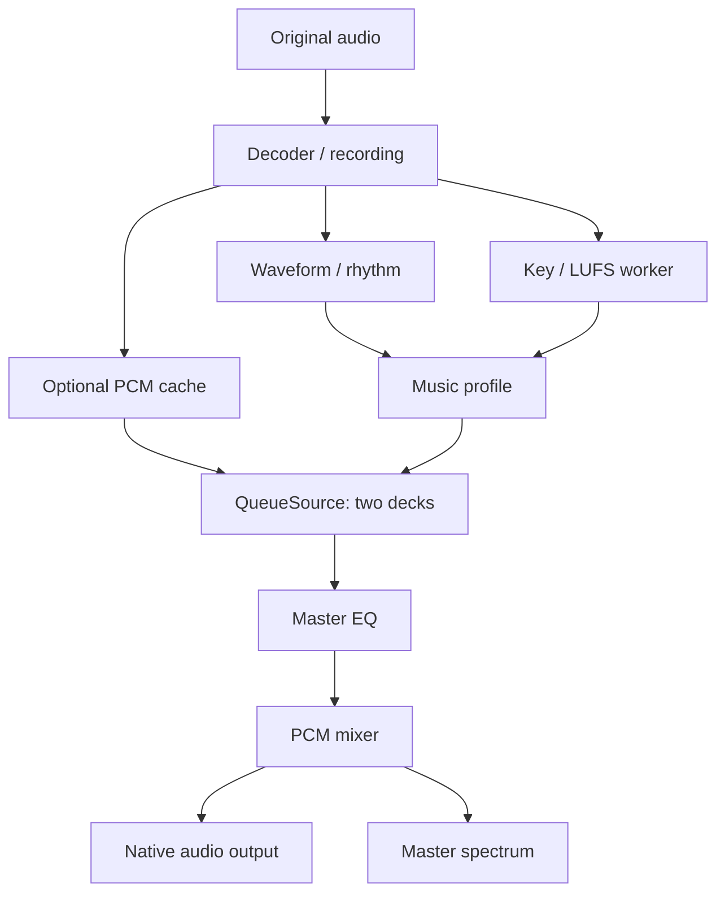

# LavPulse

English (primary) | [Русский](README.ru.md)

**LavPulse is a local music player with a two-deck DJ-style mixer, automatic transitions and detailed musical visualization.** Built on .NET 10 and .NET MAUI, it keeps audio, analysis and the library on your device. It is intended for continuous listening and experimentation with rhythm analysis, not a replacement for a professional DJ workstation.

[Download releases](https://github.com/ivmu5/LavPulse/releases) · [Report an issue](https://github.com/ivmu5/LavPulse/issues) · [License](LICENSE)

## Contents

- [Getting started](#getting-started)
- [Player and queue](#player-and-queue)
- [Media library and storage](#media-library-and-storage)
- [Music analysis](#music-analysis)
- [Sound and appearance](#sound-and-appearance)
- [Diagnostics](#diagnostics)
- [Build and run](#build-and-run)
- [Architecture](#architecture)
- [Public API](#public-api)
- [Checks and limitations](#checks-and-limitations)
- [Dependencies and license](#dependencies-and-license)
- [Continuous integration and releases](#continuous-integration-and-releases)

## Getting started

Download the release for your device. Windows releases are portable ZIP archives; extract before starting Laveyana.LavPulse.exe. Android releases provide an APK. macOS archives are unsigned; the iPhone simulator archive is **not** an installable app for a physical iPhone. See release/signing notes below.

Open the folder icon next to **Queue**, select files or a folder, then use the import/queue actions. The first playable track opens in the current deck. LavPulse remembers the local library and queue order; ordinary restoration opens the saved current track paused at its beginning.

| Platform | Import extensions |
|---|---|
| Windows | MP3, WAV, OGG/OGA (Vorbis), FLAC, AAC, M4A |
| Android | MP3, WAV, OGG/OGA (Vorbis), FLAC, AAC, M4A, OPUS |
| iOS / Mac Catalyst | MP3, WAV, OGG/OGA (Vorbis) |

Extensions are accepted candidates, not a guarantee that every codec/container variant will decode. The app has managed MP3, PCM WAV and Vorbis support and uses available system decoders for additional formats on Windows and Android.

**Open with LavPulse:** the app registers supported file types without changing your OS defaults. On Windows, launch it once, then use Settings → Playback → Opening music files → Default player, or Windows Default apps. On Android choose LavPulse in the file chooser and Always when offered. On iOS use Files → Open With; on macOS use Finder → Get Info → Open with → Change All. Availability depends on the OS.

Opening a file from the OS gives it priority at cold start without clearing the previous library/queue. Opening the current track restarts it; a different track requests a transition, waiting for any existing transition to finish. Windows forwards a repeated launch to the running instance. See [file associations](docs/system-file-associations.ru.md).

## Player and queue

| Control | Behavior |
|---|---|
| Play / pause | Configurable fade-in/fade-out; the playback position is retained when paused. |
| Previous / next | Navigate the queue or request the next prepared transition. |
| Auto mix | Automatically crossfade to the prepared successor near the end; default transition 2.5 seconds. |
| Repeat one | Repeat the current track rather than automatically advancing. |
| Current / incoming decks | The incoming track appears during a transition; it becomes current when the mix finishes. |
| Detailed waveform | Color, estimated beat grid or transient markers; configurable 5–60 s window (default 15 s). |
| Overview | Progress bar or colored overview, optionally with beat marks. Tap/drag to seek. |
| Detailed-wave drag | Preview signed scrubbing; release inside to commit, drag above the waveform to cancel. Seeking is disabled during a transition. |
| Queue | Played entries remain visible but muted; current, prepared, unprepared and analyzing states have distinct styling. |

Tap the active Queue tab again to open the editor. Drag rows to reorder, tap a track to play it, or switch to Removal to reveal delete buttons. Swipe left on an ordinary row to expose its delete action. Clear asks for confirmation; it clears the queue, not the library. The currently playing track can finish, and an ongoing crossfade is allowed to complete. Done returns to the player.

The current track is brought to the top after a track change if the queue has been idle for ten seconds. In the editor it is centered where possible. Selecting another track changes the playback/history boundary, not the order of the list. On Windows, Back/Forward mouse buttons navigate between player panels; F11 toggles fullscreen with the custom window caption hidden until needed.

The Recommendations tab is reserved for future recommendations; it is not a working streaming or AI recommendation service.

## Media library and storage

Imported audio is copied into the local library. Identical file contents share one stored original; folders organize catalog entries. Importing or removing a queue entry does not erase the original. The library shows file sizes including saved analysis and decoded PCM; the import browser shows source sizes. Folder sizes aggregate the contained entries. Swipe left or use Edit to remove catalog entries.

Rescan a selected folder or branch to refresh its analysis. Active rows pulse and offer Skip; Stop cancels the batch. Completed rows keep their colors, stop pulsing and display disk size before/after and elapsed analysis time. They move upward into scrollable history while new tasks enter below. The complete history of the current batch remains until Done. Settings → Analysis → Scan scrolling sets the independent idle return delay (0–60 s, default 10 s; 0 disables automatic return after manual scrolling).

| Analysis preference | Default | Range/meaning |
|---|---:|---|
| Analyze upcoming tracks | 10 | 0–100, compact analysis only |
| Preload upcoming tracks | 1 | 1–20, full PCM for playback |
| Concurrent library tracks | Auto | Device-dependent limit or explicit count |
| Return to active scan rows | 10 s | 0–60 s |

PCM preparation has priority; it analyzes tracks when required even when separate background analysis is disabled. Ordinary queue analysis and a first deck may use two workers on one track if CPU resources permit; library batches use one worker per track. The two-worker pipeline decodes once, passing bounded PCM blocks to the tonal/loudness worker. Analysis and artwork are reused.

**Disk use:** compact analysis contains waveforms and musical estimates, not a second audio file. Prepared tracks additionally use a seekable 48 kHz stereo PCM16 cache (about 11.52 MB/minute). Once a played deck is no longer in use or in the preload horizon, its decoded file is eligible for deletion. The last current deck stays ready for replay/seek. Cached tracks outside the horizon are pruned; original audio and compact analysis remain. Returning to an evicted track requires PCM decoding again. The horizon is a track-count limit, not a fixed byte budget.

Choose application storage, a Windows drive/folder, or supported Android app-specific shared storage/SD-card locations in Settings → Storage. Migration moves the library through the existing storage workflow; available locations and permissions depend on the platform.

## Music analysis

Analysis is automatic when needed and can be refreshed manually in the library.

| Feature | What you see or can use |
|---|---|
| Rhythm | Global and local BPM, confirmed variable-tempo beats, transient marks, rhythmic sections and subdivision evidence. Unsupported regions remain without confirmed beats. |
| Meter | Estimated repeating three- or four-pulse cycles; sufficiently confident downbeats appear as thicker lines in beat-grid mode. These are not verified musical time signatures. |
| Musical key | Major/minor estimate, Camelot notation, local tonal windows (~8.2 s at 48 kHz); Key ? means insufficient local evidence. |
| Loudness | Integrated and short-term LUFS, estimated loudness range, sample peak and proposed normalization gain. Sample peak is not true peak. |
| Energy and structure | Relative intensity, bass share and attack density; heuristic intro/outro, buildup, breakdown, silence and high/steady-energy regions in diagnostics. |
| Mix compatibility | Advisory API combining tempo, key and relative energy; it does not reorder the queue or choose harmonic transitions automatically. |

The analyzer is deterministic C# DSP, with heuristic confidence rather than calibrated probabilities. It does not yet identify chords, verified time signatures, swing, semantic verse/chorus labels or true peak. Difficult tracks can contain missing or shifted beats and uncertain tonality.

The current storage layout remains analysis-v13; individual derived profile fields have version tags. Older valid results remain readable. New audio-derived measurements require a rescan of older tracks. The rhythm-ranking and tail-recovery changes in this revision also take effect on fresh analysis/rescan; existing grids are not silently replaced.

## Sound and appearance

- Master EQ: ten bands (60, 170, 310, 600, 1k, 3k, 6k, 12k, 14k, 16k Hz), ±12 dB, and master gain; enable/disable without losing settings.
- Optional loudness normalization: off by default, target −14 LUFS, maximum boost +6 dB, 3 dB sample-peak headroom. Applied separately to each deck before mixing; transitions in gain are smoothed. Unmeasured tracks keep unity gain. No true-peak limiter guarantee.
- Mirrored master spectrum with optional peaks, frequency gradient/split/monochrome colors, signal-dependent brightness, minimum/full-brightness thresholds, side width and vertical padding. It measures the output after EQ.
- System/light/dark themes, classic or AMOLED dark background, Laveyana/Ocean/Warm/Mint palettes and custom colors with live previews.
- Interface and FPS: Auto follows the display clock; 30/60/90/120 FPS, with 144/165/240/360 also available on Windows. These are refresh limits, not promised measured FPS. Save commits appearance changes; Cancel restores the previous settings.
- Adjustable transport fade times, crossfade length and visual latency compensation (the latter affects presentation, not the audio).
- Background playback and OS media controls where supported; lock-screen integration and Android status-bar preference. Rendering is suspended when the player is not visible, while audio/eligible background work continues.

## Diagnostics

Use the deck's Rhythm button to tap beats manually, and mark problematic or strong-rhythm intervals with comments. These marks are diagnostic data; they do not retrain the analyzer automatically or edit its grid. Settings → Diagnostic reports can copy a text summary, export ZIP with originals, or clear reports. The export includes saved annotations and a fresh numerical analysis trace: waveforms, onsets, tempo evidence, predicted/confirmed beats, section attempts, local keys, downbeats, loudness and energy/structure CSVs.

Exports may include the actual music files and personal notes. Review the archive before sharing; share only audio you have rights to share. Nothing needs to be uploaded for ordinary local analysis.

## Build and run

Open [LavPulse.slnx](LavPulse.slnx) with .NET 10 SDK and MAUI workloads. Android needs the Android SDK and JDK 21; Apple builds need a Mac and compatible Xcode. Windows requires the WinUI/MAUI tooling. Run restore after changing SDK/workloads.

| Target | Command |
|---|---|
| Windows | dotnet build samples/LavPulse/LavPulse.csproj -c Debug |
| Android | dotnet build samples/LavPulse/LavPulse.Android.csproj -c Debug -p:AndroidPackageFormats=apk |
| iPhone simulator (Apple Silicon) | dotnet build samples/LavPulse/LavPulse.csproj -c Debug -p:LavPulsePlatform=ios -p:RuntimeIdentifier=iossimulator-arm64 -p:EnableCodeSigning=false |

Use [build.yml](.github/workflows/build.yml) and [ios.yml](.github/workflows/ios.yml) for the exact CI SDK, workloads, Mac Catalyst parameters and signing/smoke-test steps. Physical iPhone builds require ios-arm64 and Apple signing. In Visual Studio choose LavPulse.Android as startup project for Android and enable Build/Deploy in Configuration Manager. Windows and Android intermediate outputs are separated in Directory.Build.props.

## Architecture



| Location | Responsibility |
|---|---|
| [src/Laveyana.Audio](src/Laveyana.Audio) | PCM contracts, SIMD mixing, FFT spectrum |
| [src/Laveyana.Audio.Playback](src/Laveyana.Audio.Playback) | Decoders, preparation, analysis, cache readers, deck sessions and EQ |
| [src/LavPulse.Controls](src/LavPulse.Controls) | MAUI controls, virtualized track lists, visual frame clocks, gestures |
| [samples/LavPulse](samples/LavPulse) | Application host, library, queue, settings, OS audio/file integration |
| [tests/Laveyana.Audio.Playback.Checks](tests/Laveyana.Audio.Playback.Checks) | Executable deterministic regression suite |

The native output uses 48 kHz stereo float render blocks (1,024 frames); cache and Android/Windows output are PCM16, Apple uses AVAudioEngine float buffers. QueueSource publishes immutable state with a single render owner; control edits do not dispose an active reader. The audio callback still performs synchronous cached file reads and is not hard real-time. Background analysis is bounded; producers/consumers join during cancellation, and same-path analysis/PCM writes serialize. Queue/cache/library lifetime belongs to the window. UI changes are dispatched, artwork is downscaled, rows virtualized, and spectrum/history searches bounded.

Analysis is separated into [models](src/Laveyana.Audio.Playback/Analysis/TrackBeatGrid.cs), [tempo estimation](src/Laveyana.Audio.Playback/Analysis/TrackRhythmAnalyzer.cs), [section tracking](src/Laveyana.Audio.Playback/Analysis/TrackRhythmAnalyzer.Sections.cs), [recovery](src/Laveyana.Audio.Playback/Analysis/TrackRhythmAnalyzer.Recovery.cs), [signal helpers](src/Laveyana.Audio.Playback/Analysis/TrackRhythmAnalyzer.Signal.cs), [tonality](src/Laveyana.Audio.Playback/Analysis/MusicalKeyAnalyzer.cs), [loudness](src/Laveyana.Audio.Playback/Analysis/TrackLoudnessAnalyzer.cs), [profile](src/Laveyana.Audio.Playback/Analysis/TrackMusicProfileAnalyzer.cs) and [compatibility](src/Laveyana.Audio.Playback/Analysis/MixCompatibilityAnalyzer.cs).

See [audio pipeline](docs/audio-pipeline.ru.md), [two-worker analysis](docs/parallel-track-analysis.ru.md), [music profile](docs/music-analysis-profile.ru.md), and [iterative audit](docs/iterative-audit.md) for implementation details and caveats.

## Public API

The DSP and playback libraries have **no MAUI dependency**. External hosts supply an [`IAudioOutput`](src/Laveyana.Audio.Playback/Session/IAudioOutput.cs) implementation; the Android and Windows implementations in the sample host are internal.

```csharp
using Laveyana.Audio.Playback;

static async Task PlayFileAsync(
    string audioPath, string cacheDirectory, IAudioOutput output,
    CancellationToken token)
{
    var preparation = new TrackPreparation(cacheDirectory);
    var track = await preparation.ImportAsync(TrackFile.FromPath(audioPath), token);
    try
    {
        using var session = new QueuePlaybackSession();
        session.SetFirst(track);
        session.SetEqualizer(EqualizerSettings.Flat.WithEnabled(true).WithGain(0, 3));
        await session.RunAsync(output, token);
    }
    finally
    {
        track.Delete();
    }
}
```

[`PcmMixer`](src/Laveyana.Audio/Mixing/PcmMixer.cs) can also mix independent `IPcmSource` inputs with shared sample rates, without a queue. The ten EQ frequencies are published in [`EqualizerSettings.Frequencies`](src/Laveyana.Audio.Playback/Session/Equalizer/EqualizerSettings.cs).

<details>
<summary>Playback integration contract</summary>

`IAudioOutput.PlayAsync(IAudioRenderSource, CancellationToken)` repeatedly requests interleaved stereo frames from `IAudioRenderSource.Render`. It must not call `Render` concurrently and should report device-consumed frames with `ReportOutputPosition` when supported. The current formats are centralized in [`PlaybackFormat`](src/Laveyana.Audio.Playback/Session/PlaybackFormat.cs): 48,000 Hz, two channels and 1,024-frame render blocks. The mixer and platform adapter contract use `float` samples. Cache files and Android/Windows output use PCM16. The Apple adapter supplies separate `float` buffers for each channel to AVAudioEngine. A `CachedTrack` owns its decoded PCM file; delete it only after all playback readers have finished.

For one-shot, independently controlled decks, [`PlaybackSession`](src/Laveyana.Audio.Playback/Session/PlaybackSession.cs) takes an output adapter, `DeckVolumes`, prepared tracks and starting cues. For playlist playback, `QueuePlaybackSession` keeps deck cursors across pause/resume and supports `SetNext`, `RequestMix`, `Seek`, `TrySetSpeed` and `RequestPause`.

</details>


Direct calls to `TrackWaveform.Analyze` require 48 kHz interleaved stereo PCM; the import pipeline resamples encoded audio to that rate. Noncanonical custom PCM sources are rejected rather than producing incorrect rhythm coordinates.

## Checks and limitations

```bash
dotnet run --project tests/Laveyana.Audio.Playback.Checks -c Release
dotnet run --project tests/Laveyana.Audio.Playback.Checks -c Release -- --rhythm-report /path/to/report.zip
```

The first command runs the deterministic console suite (not xUnit/NUnit); the second replays saved numerical rhythm evidence and compares annotated excerpts. Test fixtures cover decoders, PCM clipping, mixing, repeat/seek, EQ, spectrum, cancellation, cache retention, queue limits, analysis profiles, rhythmic gaps, loudness and key detection. Real-device playback, gestures, OS integration, audio timing and accuracy on real music require separate checks. Report replays are not a substitute for decoding the original audio, and manual taps may be sparse or subdivisions.

Current limits: two decks, one stereo master output, no streaming providers, no recommendation engine, no beat-matched time stretching/pitch locking, no automatic harmonic selection, no guaranteed low-latency disk access. The API supports pitch-changing rate resampling, but playback speed has been removed from the current player UI. Some features and accepted formats depend on system codecs. Cached analysis can be wrong; use diagnostics and rescan as needed.

## Dependencies and license

The shared UI foundation is [Laveyana.Maui.UI](https://www.nuget.org/packages/Laveyana.Maui.UI/) and, on Windows only, [Laveyana.Maui.UI.Windows](https://www.nuget.org/packages/Laveyana.Maui.UI.Windows/). The Android-only [Laveyana.Maui.UI.Android](https://www.nuget.org/packages/Laveyana.Maui.UI.Android/) provides window and screen lifecycle helpers. All three packages are pinned together in [MauiPlatforms.props](MauiPlatforms.props), with a matching Microsoft.Maui.Controls version. The player consumes the shared palette catalog, semantic theme calculation, text/button factories and Windows chrome; it retains its audio visualization, transport, local settings and legacy window fallback. General-purpose UI improvements should be made in [Laveyana.Maui.UI](https://github.com/ivmu5/Laveyana.Maui.UI), not copied between apps. The shared packages retain their own license.

LavPulse is source-available under the [LavPulse Noncommercial Source License 1.0](LICENSE). Personal use, study, modification and noncommercial redistribution are permitted; distributed forks and binaries must have their corresponding source publicly available under the same terms. Commercial use by third parties requires separate written permission from the copyright holder. The copyright holder retains the right to commercialize and separately license material they own or have rights to license. Rights previously granted under MIT remain effective; see [historical MIT notice](LICENSES/previous-MIT.txt). Contributions are governed by [CONTRIBUTING.md](CONTRIBUTING.md). This is not an OSI-approved open-source license. 

Main external dependencies include [NVorbis 0.10.5](https://www.nuget.org/packages/NVorbis/0.10.5) (managed Vorbis decoding), [NLayer 3.0.1](https://www.nuget.org/packages/NLayer/3.0.1) (MP3 decoding, MIT), [NAudio.WinMM 2.2.1](https://www.nuget.org/packages/NAudio.WinMM/2.2.1) (Windows WaveOut, MIT), and [Microsoft.Maui.Controls](https://github.com/dotnet/maui) (cross-platform UI, MIT). The bundled Inter font uses the SIL Open Font License, with its text at [`Inter-OFL.txt`](samples/LavPulse/Resources/Fonts/Inter-OFL.txt). Retain third-party copyright/license notices when redistributing dependencies or fonts.

## Continuous integration and releases

Every PR targeting `master` runs the playback checks and Release builds for Windows x64, Android, the iPhone x64 simulator, and universal Mac Catalyst. These checks are advisory for merging; the repository owner can merge without waiting when branch rules do not require status checks. A push or merge into `master` does not start this workflow or publish a release. Release publication is manually triggered and still requires all tests, builds, and artifact validation to succeed. The simulator is also launched as a smoke test. The separate iPhone simulator workflow remains available for troubleshooting.

The release tag and in-app version use `vMAJOR.YY.MM.REVISION`, e.g. `v1.26.11.01`. Set the major version in [Version.props](Version.props). The month and year use UTC; the revision increments from 01 within the month, including across major changes. CI reserves a tag only after all builds succeed. A retry for a tagged commit reuses its version; local/PR builds use revision 00. The Apple OS marketing version has three components, with the monthly revision in its build number; the complete version appears in Settings. Android uses a monotonically ordered integer version code.

[GitHub Releases](https://github.com/ivmu5/LavPulse/releases) contain a Windows x64 portable ZIP, an APK, an unsigned universal macOS app ZIP, an iOS x64 simulator ZIP (not an IPA for physical devices), and SHA256SUMS.txt. iOS device distribution and macOS notarization require Apple signing credentials and are not configured. No Linux MAUI app target exists in this repository.

### Android signing

Without secrets, the APK is signed with the runner's debug key and the release is marked as a pre-release. Such APKs cannot reliably update an installation signed with a different key. For stable APK updates, use the same persistent keystore used for the installed app, and configure repository **Settings → Secrets and variables → Actions**:

| Secret | Value |
|---|---|
| `ANDROID_KEYSTORE_BASE64` | Base64 representation of the keystore file |
| `ANDROID_KEY_ALIAS` | Key alias |
| `ANDROID_KEY_PASSWORD` | Key password |
| `ANDROID_KEYSTORE_PASSWORD` | Keystore password |

Keep the keystore and passwords backed up outside GitHub; do not commit them. All four secrets must be configured together. Only master release builds receive them. The workflow does not publish to app stores.

Manual releases: **Actions → Build and release → Run workflow → master → Run workflow**. The `publish_release` option is enabled by default; disable it to run a build without publication, including on another branch. A tagged published commit is not overwritten. If a delayed retry collides with another release tag, rerun all jobs to allocate a fresh number. The release job needs repository permission to create tags and releases. To retain immediate merging, leave required status checks disabled in the master branch rules. This does not bypass the release checks.
