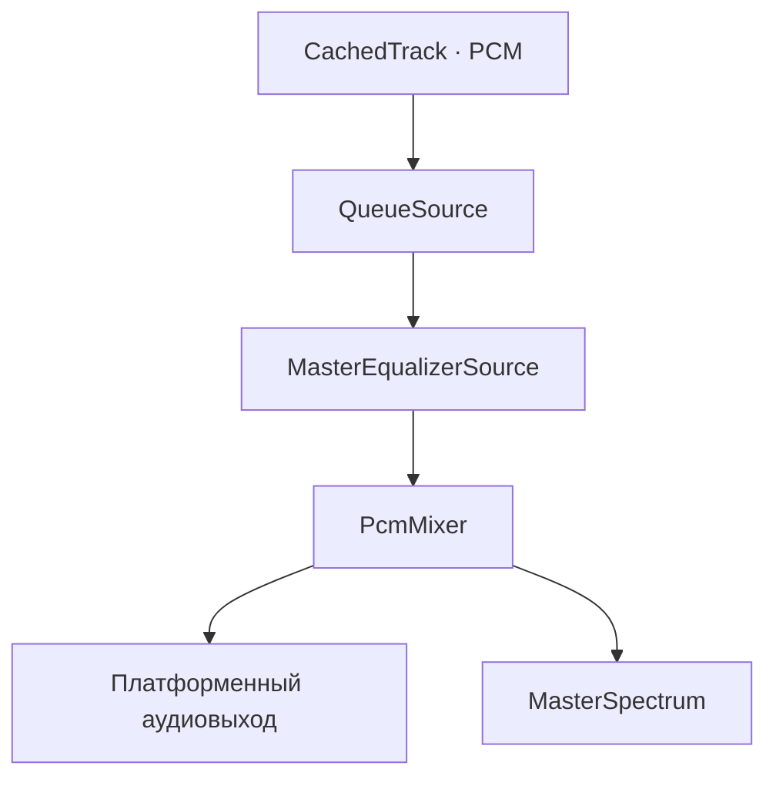

# LavPulse

[English](README.md) | Русский

LavPulse — локальный MP3-проигрыватель с двухдековым DJ-микшером на .NET 10 и .NET MAUI.

Приложение декодирует треки в PCM-кэш с произвольным доступом, сводит их в общий стереопоток 48 кГц, применяет мастер-эквалайзер и отображает волны и спектр итогового сигнала. Windows, Android и iOS используют платформенные аудиовыходы и системные медиакнопки; микшер и логика очереди общие.

## Содержание

- [Сборка и запуск](#сборка-и-запуск)
- [Возможности](#возможности)
- [Архитектура](#архитектура)
- [Навигация по репозиторию](#навигация-по-репозиторию)
- [Основные потоки выполнения](#основные-потоки-выполнения)
- [Публичный API](#публичный-api)
- [Жизненный цикл и потоки](#жизненный-цикл-и-потоки)
- [Проверки](#проверки)
- [Ограничения](#ограничения)
- [Точки расширения](#точки-расширения)
- [Зависимости и лицензия](#зависимости-и-лицензия)

## Сборка и запуск

Открой [`Laveyana.Audio.Maui.slnx`](Laveyana.Audio.Maui.slnx) в Visual Studio с установленными **.NET 10 SDK** и workload **.NET MAUI**. Для Android нужны Android SDK и JDK 21. Для Windows нужны инструменты WinUI/MAUI, для iOS — Mac, совместимый Xcode и нагрузка `maui-ios`.

| Цель | Проект | Команда |
|---|---|---|
| Windows | `Laveyana.Audio.Maui.csproj` | `dotnet build samples/Laveyana.Audio.Maui/Laveyana.Audio.Maui.csproj -c Debug` |
| Android | `Laveyana.Audio.Maui.Android.csproj` | `dotnet build samples/Laveyana.Audio.Maui/Laveyana.Audio.Maui.Android.csproj -c Debug -p:AndroidPackageFormats=apk` |

На Mac собери версию для симулятора iPhone следующими командами. Версии SDK и Xcode для воспроизводимой сборки указаны в [проверке iOS](.github/workflows/ios.yml). Для физического устройства выбери `ios-arm64` и настрой подпись команды разработчика Apple.

```bash
dotnet workload install maui-ios
dotnet build samples/Laveyana.Audio.Maui/Laveyana.Audio.Maui.csproj -c Debug -p:LavPulsePlatform=ios -p:RuntimeIdentifier=iossimulator-arm64 -p:EnableCodeSigning=false
```

Перед установкой в симулятор через `simctl install` подпиши созданный пакет командой `codesign --force --deep --sign - path/to/Laveyana.Audio.Maui.app`.

После смены платформы или обновления workload выполни `dotnet restore Laveyana.Audio.Maui.slnx`. Решение разделяет промежуточные каталоги Windows и Android (см. [`Directory.Build.props`](Directory.Build.props)), чтобы не смешивать NuGet-ресурсы и не получать слишком длинные пути Android.

Значок папки рядом с вкладкой **Очередь** открывает медиатеку. В окне импорта кнопки добавления в очередь и в медиатеку сразу видны в каждой строке. У сохранённых треков и папок постоянно видна кнопка добавления в очередь. Рядом с папкой указан суммарный размер MP3 внутри неё и во вложенных папках. Выбери нужную ветку для импорта или пересканирования. При пересканировании карточка текущего трека мигает под полосой прогресса. **Пропустить** переходит к следующему треку, **Остановить** завершает проход. В сохранённой медиатеке свайп влево открывает корзину, а **Редактирование** показывает её у всех доступных для удаления строк. Корзина медиатеки убирает запись из каталога. При выходе из медиатеки режим редактирования сбрасывается.

Очередь плеера показывает и прослушанные треки. При смене трека после десяти секунд без действий с очередью играющая строка прокручивается к верху списка. Повторное нажатие активной вкладки **Очередь** открывает редактор. В нём играющий трек центрируется, если хватает строк, и сразу видны полоски перетаскивания и корзины. В обычной очереди корзину открывает свайп влево. **Готово** возвращает в плеер.

На Windows боковые кнопки мыши **Назад** и **Вперёд** работают для переходов между плеером, панелями и редакторами. При открытии нового экрана история переходов вперёд сбрасывается.

Кнопка **▾** рядом со скоростью деки открывает значения от **0,75× до 1,25×** с шагом **0,05×**. Значение можно ввести вручную. Колёсико над полем в Windows меняет скорость на **0,01×** за шаг.

Раздел **Настройки → Интерфейс и FPS** задаёт ограничение для мастер-спектра, указателей и переходов дек, анимаций очереди и полноэкранной шапки Windows. В режиме **Авто** анимации следуют кадровому циклу дисплея. Доступны 30, 60, 90 и 120 FPS, а на Windows также 144, 165, 240 и 360 FPS. Изменения видны сразу. **Сохранить** запоминает выбор, **Отмена** возвращает прежний. Нативная прокрутка и FFT работают со своими интервалами. Android повторно запрашивает выбранную частоту после пробуждения и возврата фокуса.

MP3 можно запустить из системного файлового менеджера. В Windows один раз запусти LavPulse из папки, где он будет храниться, затем выбери его в **Параметры → Приложения → Приложения по умолчанию → .mp3**. На Android выбери LavPulse в меню открытия файла и нажми **Всегда**, если система предложит эту кнопку. На iPhone выбери LavPulse в меню **Открыть с помощью** приложения «Файлы». В версиях «Файлов», где доступен выбор приложения по умолчанию для типа файла, он находится в сведениях о MP3. На Mac это можно сделать через **Finder → Свойства → Открывать в приложении → Настроить для всех**.

## Возможности

- Две деки с ручным или автоматическим гиперболическим кроссфейдом, плавным стартом/паузой, повтором одного трека и изменяемой скоростью.
- Десятиполосный мастер-эквалайзер и общее усиление, применяемые **до** расчёта мастер-спектра.
- Детальная и обзорная волны, перемотка жестами, частотный спектр и анимации смены дек.
- Восстанавливаемое дерево папок и редактируемая очередь, локальные копии MP3 и последовательный фоновый анализ.
- Фоновое воспроизведение и системные медиакоманды на Android, Windows и iOS.

## Архитектура

UI не декодирует MP3 в аудиопотоке. Подготовленный трек содержит PCM-кэш и данные волны. Одна аудиосессия сводит деки, применяет мастер-эквалайзер и передаёт позицию фактически воспроизводимого сигнала.



| Слой | Ответственность | Точки входа |
|---|---|---|
| Базовая DSP-логика | Стереосведение, PCM-контракт, частотный анализ | [`IPcmSource`](src/Laveyana.Audio/IPcmSource.cs), [`PcmMixer`](src/Laveyana.Audio/PcmMixer.cs), [`MasterSpectrum`](src/Laveyana.Audio/MasterSpectrum.cs) |
| Подготовка и воспроизведение | Декодирование, кэш, деки, эквалайзер, интерфейс аудиовывода | [`TrackPreparation`](src/Laveyana.Audio.Playback/Tracks/TrackPreparation.cs), [`QueuePlaybackSession`](src/Laveyana.Audio.Playback/Session/QueuePlaybackSession.cs), [`IAudioOutput`](src/Laveyana.Audio.Playback/Session/IAudioOutput.cs) |
| Приложение | Медиатека, порядок очереди, команды, жизненный цикл платформы | [`MainPage`](samples/Laveyana.Audio.Maui/MainPage.cs), [`PlayerLibrary`](samples/Laveyana.Audio.Maui/Tracks/PlayerLibrary.cs), [`PlaybackQueue`](samples/Laveyana.Audio.Maui/Tracks/PlaybackQueue.cs) |
| Представления | MAUI-компоненты на C# и обработка жестов | [`PlayerView`](src/Laveyana.Audio.Maui.Controls/Views/PlayerView.cs), [`DeckView`](src/Laveyana.Audio.Maui.Controls/Views/DeckView.cs), [`TrackQueueView`](src/Laveyana.Audio.Maui.Controls/Views/TrackQueueView.cs) |

<details>
<summary>Подробности аудиоядра и очереди</summary>

[`QueueSource`](src/Laveyana.Audio.Playback/Session/QueueSource.cs) владеет PCM-ридерами текущего и подготовленного следующего треков, управляет перемоткой и скоростью, после перехода переносит входящую деку в текущую. Ручной переход запрашивается до следующего аудиоблока. [`MasterEqualizerSource`](src/Laveyana.Audio.Playback/Session/MasterEqualizerSource.cs) фильтрует уже **сведённый** сигнал с помощью десяти полос пиковых фильтров и каскада усиления; при изменении настроек плавно переключаются состояния фильтров. [`MixedPlayback`](src/Laveyana.Audio.Playback/Session/MixedPlayback.cs) формирует блоки и публикует результаты FFT с учётом позиции фактического аудиовывода, когда платформа её предоставляет.

[`PlayerLibrary`](samples/Laveyana.Audio.Maui/Tracks/PlayerLibrary.cs) ограничивает количество параллельных декодирований, объединяет одинаковые запросы и защищает от вытеснения занятые деки и до десяти следующих треков. Фоновый поток готовит их по порядку, затем сохраняет компактный анализ остальных треков очереди. Выбранный пользователем трек может использовать ещё один слот декодирования. Упорядоченная [`PlaybackQueue`](samples/Laveyana.Audio.Maui/Tracks/PlaybackQueue.cs) не переставляет записи при выборе другого трека: текущая позиция определяет границу прослушанной истории.

</details>

## Навигация по репозиторию

```text
src/Laveyana.Audio/                 PCM mixing and FFT
src/Laveyana.Audio.Playback/        MP3 preparation, cache, queue mixer, EQ
src/Laveyana.Audio.Maui.Controls/   C# player UI and platform gestures
samples/Laveyana.Audio.Maui/       MAUI host, media library, settings, output adapters
tests/Laveyana.Audio.Playback.Checks/  Executable regression checks
```

[`MainPage`](samples/Laveyana.Audio.Maui/MainPage.cs) владеет состоянием приложения и подписками UI. Отдельные сценарии расположены в `MainPage.Import.cs`, `MainPage.Queue.cs`, `MainPage.Analysis.cs`, `MainPage.Transport.cs`, `MainPage.Rendering.cs`, `MainPage.SystemPlayback.cs`, `MainPage.Dialogs.cs` и `MainPage.State.cs`. Реализация карточки обложки очереди находится в [`TrackQueueView.TrackCard.cs`](src/Laveyana.Audio.Maui.Controls/Views/TrackQueueView.TrackCard.cs).

Очередь, её редактор и дерево медиатеки используют общий виртуализированный список и разметку строк. Каждый экран задаёт свои действия и метаданные обложек.

## Основные потоки выполнения

- **Импорт.** `MainPage.AddFilesAsync` добавляет записи через `PlayerLibrary.Add`. `LoadFirstAsync` готовит первую деку, а `TrackPreparation.ImportAsync` создаёт PCM-кэш и волну. `UpdateQueueAnalysis` передаёт список ближайших файлов в `QueueTrackAnalysis`.
- **Выбор трека.** `ChooseAsync` запрашивает переход через `StartMixAsync`. `ArmAsync` подготавливает выбранный трек для следующей деки. `QueuePlaybackSession.RequestMix` передаёт запрос в `QueueSource`.
- **Воспроизведение.** `QueuePlaybackSession.RunAsync` запускает нативный аудиовыход. Тот запрашивает у `MixedPlayback.Render` блоки стерео PCM из цепочки на схеме выше.

На Android импорт сначала пробует системный декодер MP3 через `MediaExtractor` и `MediaCodec`. Приложение копирует MP3 в свой локальный каталог. Файлы с одинаковым содержимым используют одну копию. Если системный декодер не справился, импорт начинается заново через NLayer. Оба пути сохраняют волну в одном формате и при подготовке деки пишут PCM16-кэш 48 кГц в стерео с произвольным доступом. После перезапуска LavPulse восстанавливает порядок очереди и открывает текущий трек на паузе с начала.

## Публичный API

Библиотеки DSP и воспроизведения **не зависят от MAUI**. Внешний хост передаёт реализацию [`IAudioOutput`](src/Laveyana.Audio.Playback/Session/IAudioOutput.cs); Android- и Windows-реализации в приложении имеют внутреннюю область видимости.

```csharp
using Laveyana.Audio.Playback;

static async Task PlayFileAsync(
    string mp3Path, string cacheDirectory, IAudioOutput output,
    CancellationToken token)
{
    var preparation = new TrackPreparation(cacheDirectory);
    var track = await preparation.ImportAsync(TrackFile.FromPath(mp3Path), token);
    try
    {
        using var session = new QueuePlaybackSession();
        session.SetFirst(track);
        session.SetEqualizer(EqualizerSettings.Flat.WithEnabled(true).WithGain(0, 3));
        await session.RunAsync(output, token);
    }
    finally
    {
        track.Delete();
    }
}
```

[`PcmMixer`](src/Laveyana.Audio/PcmMixer.cs) может также сводить независимые входы `IPcmSource` с одинаковой частотой дискретизации, без очереди. Частоты десяти полос опубликованы в [`EqualizerSettings.Frequencies`](src/Laveyana.Audio.Playback/Session/EqualizerSettings.cs).

<details>
<summary>Контракт интеграции аудиовывода</summary>

`IAudioOutput.PlayAsync(IAudioRenderSource, CancellationToken)` многократно запрашивает чередующиеся стереосэмплы через `IAudioRenderSource.Render`. Нельзя вызывать `Render` одновременно из нескольких потоков; при наличии счётчика воспроизведённых кадров следует передавать их через `ReportOutputPosition`. Текущий формат определён в [`PlaybackFormat`](src/Laveyana.Audio.Playback/Session/PlaybackFormat.cs): 48 000 Гц, два канала, блоки по 1 024 кадра. Внутри микшера и на входе платформенного адаптера сэмплы хранятся как `float`. Кэш и выходы Android/Windows используют PCM16. Адаптер Apple передаёт в AVAudioEngine `float` по отдельному буферу на канал. `CachedTrack` владеет декодированным PCM-файлом; удалять его можно только после завершения чтения всеми воспроизводящими сессиями.

Для однократного воспроизведения двух независимо управляемых дек [`PlaybackSession`](src/Laveyana.Audio.Playback/Session/PlaybackSession.cs) принимает аудиоадаптер, `DeckVolumes`, подготовленные треки и начальные позиции. Для воспроизведения очереди `QueuePlaybackSession` сохраняет позиции дек между паузой и продолжением и предоставляет `SetNext`, `RequestMix`, `Seek`, `TrySetSpeed` и `RequestPause`.

</details>

## Жизненный цикл и потоки

- `MainPage` владеет `PlayerLibrary`, `PlaybackQueue`, `QueuePlaybackSession` и мостом системного плеера; `CloseAsync` отменяет и дожидается завершения воспроизведения и анализа перед освобождением аудиоридеров.
- Импорт и расчёт волн выполняются асинхронно с ограниченным числом декодеров. Нативный аудиовыход получает PCM в собственном потоке; C# MAUI-представления и состояние очереди обновляются через UI-диспетчер.
- У микшера один поток вызова `Render`. `QueueSource` синхронизирует изменения текущей и следующей дек; последний снимок для UI читается отдельно. Соответствие декодированных треков их файлам хранится в потокобезопасном словаре.
- При сворачивании подготовка треков продолжается независимо от обновления интерфейса. На Android запущенную из плеера задачу поддерживает фоновый сервис с системным уведомлением. На iOS подготовка работает во время фонового воспроизведения. На паузе iOS даёт ограниченное время, а оставшиеся треки готовятся после возврата в плеер. На Windows подготовка продолжается при свёрнутом окне.
- При сворачивании микшер продолжает работать. Android использует фоновый медиасервис, Windows публикует System Media Transport Controls, iOS использует AVAudioSession и Now Playing.

<details>
<summary>Производительность и владение ресурсами</summary>

Порог вытеснения 256 МиБ применяется к декодированному PCM. Занятые деки, выбранный трек и ближайшие записи остаются на диске, даже если их суммарный размер превышает порог. После вытеснения PCM данные анализа остаются на диске. При повторном декодировании сохранённая волна используется, если число кадров совпадает. Удаление строки меняет сохранённую очередь и оставляет импортированную копию в локальном каталоге. Строки очереди виртуализированы; полноразмерные обложки ID3 уменьшаются до миниатюр. Геометрия волны кэшируется отдельно от указателя; анализатор спектра отключается при скрытии мастер-спектра.

Основной микшер пишет сигнал от единственного источника сразу в выходной блок. При необходимости он применяет усиление, ограничивает амплитуду и заполняет хвост блока тишиной. На скорости 1× и целочисленной позиции чтение PCM16 использует SIMD при аппаратной поддержке. При другой скорости или дробной позиции сохраняется интерполяция.

Разбор ID3 берёт временный буфер из пула и копирует только выбранную обложку. Очередь и деки читают обложки из уже выделенных массивов. В спектре оттенок заданной яркости создаётся при первом использовании и повторно используется до смены соответствующего цвета или режима.

Платформенные адаптеры работают через AudioTrack, WaveOut и AVAudioEngine. [Android](samples/Laveyana.Audio.Maui/Platforms/Android/PlatformAudioOutput.cs) · [Windows](samples/Laveyana.Audio.Maui/Platforms/Windows/PlatformAudioOutput.cs) · [Apple](samples/Laveyana.Audio.Maui/Apple/PlatformAudioOutput.cs)

[`AndroidMediaPlaybackService`](samples/Laveyana.Audio.Maui/Platforms/Android/AndroidMediaPlaybackService.cs) предоставляет системные кнопки Android, а [`WindowsMediaIdentity`](samples/Laveyana.Audio.Maui/Platforms/Windows/WindowsMediaIdentity.cs) регистрирует идентификатор приложения Windows без MSIX.

</details>

## Проверки

[`Laveyana.Audio.Playback.Checks`](tests/Laveyana.Audio.Playback.Checks/Program.cs) — исполняемый консольный набор регрессионных проверок, **не** проект xUnit/NUnit:

```bash
dotnet run --project tests/Laveyana.Audio.Playback.Checks -c Release
```

Проверяются сведения о MP3-кадрах, выбор ID3-обложки, чтение PCM16, сведение и заполнение тишиной, захват спектра, плавные переходы транспорта, перемотка и скорость, история очереди, повтор трека, мастер-эквалайзер и очистка после ошибки аудиовывода. Детерминированные проверки аудиоинвариантов следует добавлять сюда; нативные жесты MAUI, фоновое воспроизведение и системные медиасессии проверяются на соответствующих устройствах. [`build.yml`](.github/workflows/build.yml) запускается вручную.

Проверка iOS запускается вручную через **Actions → iPhone simulator → Run workflow**. После появления новой версии workflow в `master` в меню запуска можно выбрать нужную ветку. Проверка собирает приложение и запускает его на симуляторе iPhone. [Конфигурация iOS](.github/workflows/ios.yml)

Для ручной проверки iOS импортируй два MP3 из «Файлов», проверь сведение, эквалайзер и перемотку, затем заблокируй экран и проверь кнопки Now Playing.

## Ограничения

- Импорт поддерживает локальные **MP3**, а не потоковые сервисы или произвольные кодеки. Декодирование принимает моно/стерео MP3 с исходной частотой до 48 кГц.
- Изменение скорости деки выполняется ресэмплингом и **меняет высоту звука**; сохранение тона при изменении темпа и автоматическое совмещение битов здесь не реализованы.
- Микшер содержит две деки воспроизведения и один итоговый стереовыход. Перечисление или синхронизация нескольких физических аудиоустройств не реализованы.
- Рекомендации пока представлены заглушкой в UI.
- В Windows буферизация WaveOut может добавлять задержку; системные кнопки и фоновое воспроизведение зависят от ОС и устройства.

## Точки расширения

| Задача | С чего начать |
|---|---|
| Добавить декодер или новый источник данных | [`IPcmSource`](src/Laveyana.Audio/IPcmSource.cs), [`TrackPreparation`](src/Laveyana.Audio.Playback/Tracks/TrackPreparation.cs) |
| Изменить сведение, паузу или скорость дек | [`QueueSource`](src/Laveyana.Audio.Playback/Session/QueueSource.cs), [`TransportFadeSource`](src/Laveyana.Audio.Playback/Session/TransportFadeSource.cs) |
| Изменить эквалайзер или спектральный анализ | [`MasterEqualizerSource`](src/Laveyana.Audio.Playback/Session/MasterEqualizerSource.cs), [`MasterSpectrum`](src/Laveyana.Audio/MasterSpectrum.cs) |
| Изменить очередь, историю или фоновую подготовку | [`MainPage.Queue.cs`](samples/Laveyana.Audio.Maui/MainPage.Queue.cs), [`MainPage.Analysis.cs`](samples/Laveyana.Audio.Maui/MainPage.Analysis.cs), [`PlaybackQueue`](samples/Laveyana.Audio.Maui/Tracks/PlaybackQueue.cs) |
| Изменить жесты, волны или компоновку плеера | [`DeckView`](src/Laveyana.Audio.Maui.Controls/Views/DeckView.cs), [`TrackQueueView`](src/Laveyana.Audio.Maui.Controls/Views/TrackQueueView.cs), [`WaveformDrawable`](src/Laveyana.Audio.Maui.Controls/Views/WaveformDrawable.cs) |
| Добавить нативный выход или системную медиасессию | [`IAudioOutput`](src/Laveyana.Audio.Playback/Session/IAudioOutput.cs), [`SystemPlaybackIntegration`](samples/Laveyana.Audio.Maui/SystemPlaybackIntegration.cs) |

## Зависимости и лицензия

LavPulse распространяется под лицензией [MIT](LICENSE). Основные внешние зависимости: [NLayer 3.0.1](https://www.nuget.org/packages/NLayer/3.0.1) (декодирование MP3, MIT), [NAudio.WinMM 2.2.1](https://www.nuget.org/packages/NAudio.WinMM/2.2.1) (Windows WaveOut, MIT) и [Microsoft.Maui.Controls](https://github.com/dotnet/maui) (кроссплатформенный UI, MIT). Встроенный шрифт Inter распространяется по SIL Open Font License; текст лицензии включён в [`Inter-OFL.txt`](samples/Laveyana.Audio.Maui/Resources/Fonts/Inter-OFL.txt). При распространении зависимостей или шрифтов необходимо сохранять соответствующие уведомления об авторских правах и лицензиях.
