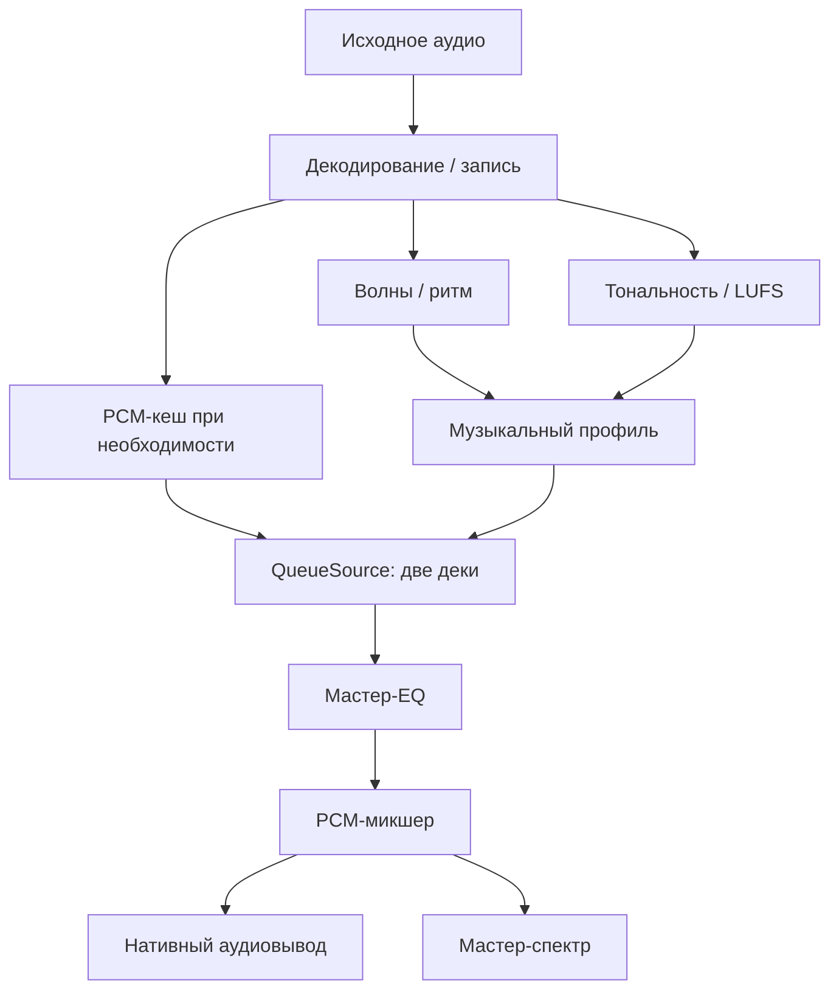

# LavPulse

[English (основная версия)](README.md) | Русский

**LavPulse — локальный музыкальный плеер с двухдечным DJ-микшером, автоматическими переходами и подробной визуализацией музыки.** Разработан на .NET 10 и .NET MAUI. Музыка, анализ и медиатека хранятся на устройстве. Приложение предназначено для непрерывного прослушивания и экспериментов с музыкальным анализом, а не заменяет профессиональную DJ-станцию.

[Скачать релизы](https://github.com/ivmu5/LavPulse/releases) · [Сообщить об ошибке](https://github.com/ivmu5/LavPulse/issues) · [Лицензия](LICENSE)

## Возможности приложения

- Непрерывное прослушивание с двумя деками, автоматическим сведением, повтором одного трека и редактируемой локальной очередью.
- Импорт файлов и вложенных папок, офлайн-медиатека, переанализ и управление дисковым пространством независимо от очереди.
- Просмотр звуковой волны, оценок BPM и тональности, долей и транзиентов; обзорная волна или прогресс, перемотка с отменяемым предпросмотром.
- Настройка мастер-EQ, нормализации громкости, спектра, FPS и оформления; экспорт диагностических отчётов при ошибках анализа.

Текущая версия имеет две деки. Рекомендации, синхронизация темпа с сохранением высоты и автоматический гармонический подбор пока не реализованы. Установка зависит от платформы.

## Адаптивная компоновка панелей

Свайпы очереди доступны как на главном экране, так и в редакторе очереди, включая Android. Они применяются к строке, на которой выполнен жест, независимо от выделенных галочками треков. Ручка перетаскивания и галочка сохраняют отдельное поведение. Во время перетаскивания или массовой операции свайпы блокируются.

Настройки, медиатека и редактор очереди используют общую центральную область. В альбомном окне от 480 до 835 логических единиц используются две колонки: основная и единственная необходимая боковая, без пустой противоположной колонки. От 836 используются три колонки. В обоих режимах навигация настроек перемещается в независимо прокручиваемую колонку слева, выбранный раздел остаётся в основной области. «Сбросить» находится сверху основной области в двухколоночном режиме и справа в трёхколоночном. В узкой боковой колонке части кнопки «Анализ» располагаются вертикально. В медиатеке «Открыть папку» и составная кнопка «Анализ» перемещаются в правую колонку; компактная кнопка «Редактировать» остаётся над списком справа. В обоих редакторах над строками расположена панель выбора: крестик и счётчик слева, отдельные значки операций справа (переносятся на следующую строку при нехватке ширины). В редакторе очереди «Очистить» находится в правой колонке, список, панель выбора и кнопка «Готово» — по центру; левая колонка зарезервирована под будущую навигацию только в трёхколоночном режиме. «Сохранить»/«Отмена» и «Назад» остаются снизу центральной области. В портретном и узком окне сохраняется вертикальная компоновка. Изменение размеров не сбрасывает выбранный раздел, изменения настроек, выделение медиатеки, сеанс анализа или отмеченные треки очереди. При смене режима компоновки активное перетаскивание отменяется, чтобы не применить перенос по устаревшим координатам. В коротком альбомном окне от 640 DIP обложка располагается слева, сведения об исходном аудиофайле — непосредственно справа от обложки (с выравниванием по левому краю верхней части центральной колонки), деки — внизу центральной колонки, очередь — справа. Боковые колонки имеют одинаковую ширину (160–220 DIP), деки находятся точно по центру и симметрично расширяются. Волны прокручиваются в пределах оставшейся высоты; в портретном режиме сведения по-прежнему находятся рядом с обложкой. Управление остаётся снизу. При смене трека обложки плавно сменяются на месте за 280 мс, уходящая дека сворачивается на общем цикле кадров, очередь остаётся видимой во время сведения; в высоком окне сохраняется вертикальный плеер. В коротком альбомном редакторе очереди кнопка «Готово» переносится в колонку действий, освобождая высоту списка. Боковые действия медиатеки прокручиваются независимо; при анализе скрываются лишние операции. Парные настройки учитывают ширину на всех устройствах. Эквалайзер распределяет полосы по доступной ширине, а в коротком альбомном окне показывает единую горизонтально прокручиваемую полосу. Редактор палитры при достаточной ширине располагает поле выбора цвета и HEX/RGB с предпросмотром в двух независимо прокручиваемых колонках. Привязанные меню закрываются при изменении размеров окна, чтобы не использовать устаревшие координаты. На Android строки используют нативное различение касаний: горизонтальный жест управляет свайпом, вертикальный передаётся прокрутке, удержание открывает контекстное меню. Отмена жеста или переиспользование строки не выполняет действие для другого элемента. Фон свайпа плавно окрашивается с начала движения до второго порога. Значки плавно смешивают светлый и тёмный варианты, подписи меняют цвет по фактическому смешанному цвету строки. Цветные превью, пункты оверлея и кнопки со сплошным фоном выбирают тёмный или светлый значок по яркости фона, независимо от темы.

## Навигация по спискам и действия

В иерархической медиатеке закрепляются до трёх ближайших родительских папок без отдельных копий строк. Неподвижный непрозрачный слой внутри списка скрывает прокручиваемые строки под родителями; те же объекты строк перемещаются между слоями только при смене закрепления. Кнопки добавления в очередь убраны: используются свайпы или контекстные действия. Нажатие на закреплённую папку сворачивает ветку и возвращает к её строке. Непроанализированный трек отмечается компактной плашкой под размером файла, отдельно от названия и исполнителя. Контекстные меню, подтверждения и результаты операций отображаются внутри приложения в тематическом оверлее; «Назад» сначала закрывает оверлей. Системные окна выбора файлов и папок остаются нативными. Кнопки завершения расположены внизу, при отложенном сохранении — широкая кнопка «Сохранить» и небольшой значок отмены (в настройках слева). В настройках свайпов для каждого списка показана одна примерная строка с текущими действиями слева и справа. Нажатие открывает выпадающий оверлей рядом с кнопкой с теми же цветами и значками, что в списках. Режим анализа и расположение хранилища также выбираются через общий выпадающий оверлей, без смещения окружающих элементов. Компактное контекстное меню строки использует значки панели редактирования, раскрывается от края точки нажатия за 120 мс на общем цикле кадров с ограничением FPS, учитывает границы окна и закрывается нажатием снаружи. Подтверждения остаются по центру. Остальные операции находятся над списком.

## Содержание

- [Начало работы](#начало-работы)
- [Плеер и очередь](#плеер-и-очередь)
- [Медиатека и хранение](#медиатека-и-хранение)
- [Музыкальный анализ](#музыкальный-анализ)
- [Звук и оформление](#звук-и-оформление)
- [Диагностика](#диагностика)
- [Сборка и запуск](#сборка-и-запуск)
- [Архитектура](#архитектура)
- [Публичный API](#публичный-api)
- [Проверки и ограничения](#проверки-и-ограничения)
- [Зависимости и лицензия](#зависимости-и-лицензия)
- [Проверочные сборки и ручные релизы](#проверочные-сборки-и-ручные-релизы)

## Начало работы

Скачайте релиз для своего устройства. Windows-версия поставляется в portable ZIP: распакуйте его и запустите Laveyana.LavPulse.exe. Для Android используется APK. Архивы macOS не подписаны, а архив симулятора iPhone **не предназначен** для установки на физический iPhone. Условия подписи описаны ниже.

Откройте значок папки рядом с вкладкой **Очередь**, выберите файлы или каталог и используйте действия импорта/добавления в очередь. Первый доступный трек открывается на текущей деке. LavPulse сохраняет медиатеку и порядок очереди; при обычном восстановлении последняя композиция открывается на паузе с начала.

| Платформа | Расширения для импорта |
|---|---|
| Windows | MP3, WAV, OGG/OGA (Vorbis), FLAC, AAC, M4A |
| Android | MP3, WAV, OGG/OGA (Vorbis), FLAC, AAC, M4A, OPUS |
| iOS / Mac Catalyst | MP3, WAV, OGG/OGA (Vorbis) |

Расширение допускает файл к импорту, но не гарантирует поддержку всех вариантов кодеков и контейнеров. MP3, PCM WAV и Vorbis имеют управляемые декодеры; дополнительные форматы на Windows и Android зависят от системных декодеров.

**Открытие через LavPulse:** приложение регистрирует поддерживаемые типы файлов, не меняя выбор пользователя в ОС. На Windows запустите плеер один раз и откройте Настройки → Воспроизведение → Открытие музыкальных файлов → Назначить плеером по умолчанию либо параметры приложений Windows. На Android выберите LavPulse и «Всегда», если система предлагает. На iOS — «Файлы» → «Открыть с помощью», на macOS — Finder → свойства файла → «Открывать в программе» → «Изменить все».

При холодном запуске открываемый файл получает приоритет, прежняя очередь и медиатека сохраняются. Повторное открытие текущего трека запускает его с начала. Другой трек переходит на деку через существующее сведение, дожидаясь окончания активного перехода. Windows передаёт файл уже работающему экземпляру. Подробнее: [ассоциации файлов](docs/system-file-associations.ru.md).

## Плеер и очередь

| Элемент | Поведение |
|---|---|
| Воспроизведение / пауза | Настраиваемое нарастание и затухание громкости; позиция сохраняется при паузе. |
| Назад / вперёд | Навигация по очереди или запрос перехода на подготовленный трек. |
| Автомикс | Автоматическое сведение со следующим треком ближе к концу текущего, по умолчанию 2,5 секунды. |
| Повтор одного | Повторяет текущую композицию вместо автоматического перехода. |
| Две деки | Входящий трек показывается при сведении и после перехода занимает место текущего. |
| Детальная волна | Цветная, ритмическая сетка или транзиенты; диапазон 5–60 с, по умолчанию 15 с. |
| Обзорная волна | Прогресс или цветная форма с сеткой/без неё. Нажатие или перетаскивание перематывает трек. |
| Жест на детальной волне | Предпросмотр перемотки; отпустить внутри для применения, увести вверх для отмены. При сведении перемотка заблокирована. |
| Очередь | Проигранные строки остаются в списке приглушёнными; текущие, готовые, незагруженные и анализируемые визуально различаются. |

Повторное нажатие вкладки «Очередь» открывает редактор. Отметьте треки галочками и нажмите значок нужного действия; порядок по-прежнему меняется перетаскиванием за ручку. Крестик закрывает режим выбора без отмены уже выполненных операций; «Готово» также возвращает в плеер. Удаление копии из хранилища по-прежнему требует подтверждения. ПКМ на Windows или долгое нажатие на телефоне открывает меню строки. В зависимости от списка доступны воспроизведение сейчас/следующим, добавление/удаление из очереди, очистка анализа, очистка и переанализ, удаление записи из медиатеки и показ файла в проводнике Windows. Удаление импортированной копии из хранилища — отдельное действие с подтверждением; исходники вне LavPulse не затрагиваются. Используемые или подготовленные треки защищены; копия в очереди не удаляется физически. Для виртуальной папки медиатеки открывается каталог импортированных файлов.

Свайпы по умолчанию: слева направо — добавить в очередь в медиатеке или переместить трек сразу после текущего в очереди; справа налево — убрать из очереди или запросить удаление копии из хранилища. Первый порог открывает кнопку, далее постепенно появляется цвет палитры. Отпускание за вторым порогом выполняет действие без нажатия кнопки. Все четыре направления настраиваются независимо в настройках воспроизведения, раздел «Свайпы в списках». Непроанализированные локальные треки приглушены и имеют отметку. При сведении у обеих дек есть состояния начала и завершения воспроизведения. «Очистить» с подтверждением очищает очередь, но не медиатеку. «Готово» возвращает в плеер.

При смене трека текущая строка прокручивается к верхней границе после десяти секунд без взаимодействия с очередью. В редакторе она по возможности центрируется. Выбор другого трека меняет границу проигранных записей, но не переставляет список. На Windows кнопки мыши «Назад»/«Вперёд» переключают панели, F11 переключает полноэкранный режим; название раздела по центру остаётся видимым независимо от скрытия общих элементов заголовка.

Вкладка «Рекомендации» пока зарезервирована; потокового сервиса или работающего рекомендательного движка нет.

## Медиатека и хранение

Импортированные композиции копируются в локальную медиатеку; одинаковое содержимое использует один сохранённый оригинал. Папки организуют записи каталога. Удаление из очереди не удаляет оригинальный файл. Размер сохранённого трека включает исходник, результаты анализа и PCM-кеш; в браузере импорта показывается размер исходного файла. Размеры папок суммируются. Смахивание влево или режим «Редактировать» позволяют удалять записи каталога.

«Открыть папку» позволяет выбрать новый источник. В локальной медиатеке слева составной кнопки «Анализ» запускается обработка, справа выбирается режим: «Только новые» пропускает треки с сохранёнными результатами (по умолчанию), «Повторный анализ» обновляет существующие результаты. Выбор режима сам по себе не запускает обработку. Действие применяется к выбранному треку или ветке папок. Активные строки пульсируют и имеют кнопку пропуска; «Остановить» завершает пакет. Готовые строки перестают мигать, сохраняют цвета, показывают размер до/после и время анализа. Они уходят вверх в историю; новые задачи появляются снизу. Вся история текущего сеанса доступна до «Готово». В Настройки → Анализ → Прокрутка анализа задаётся отдельное время автовозврата после ручной прокрутки (0–60 секунд, по умолчанию 10; 0 выключает возврат).

| Настройка | По умолчанию | Диапазон/смысл |
|---|---:|---|
| Анализировать следующих треков | 10 | 0–100, компактный анализ |
| Предзагружать следующих треков | 1 | 1–20, полный PCM |
| Одновременный анализ медиатеки | Авто | Лимит устройства или выбранное количество |
| Возврат к активному анализу | 10 с | 0–60 с |

Предзагрузка приоритетна и анализирует трек при необходимости, даже если отдельный фоновый анализ отключён. В обычной очереди и при первичной подготовке деки используются до двух рабочих потоков на композицию, если есть свободный ресурс. Массовый анализ медиатеки использует один поток на трек. Декодирование однократное; ограниченные PCM-блоки передаются потоку тональности/LUFS.

**Место на диске:** компактный анализ хранит волны и оценки, а не вторую копию звука. Подготовленная дека дополнительно использует PCM16 48 кГц stereo (около 11,52 МБ/мин). Декодированный файл сыгранного трека удаляется после выхода из дек и горизонта предзагрузки. Последняя текущая дека остаётся готовой для повтора и перемотки. Оригиналы и компактный анализ сохраняются. При возврате к сыгранному треку PCM декодируется заново. Лимит задаётся количеством треков, а не фиксированным числом байт.

В Настройки → Хранилище можно выбрать память приложения, доступный диск/папку Windows или поддерживаемые каталоги приложения в общей памяти/на SD-карте Android. Перенос выполняется существующим механизмом миграции; доступ зависит от разрешений ОС.

При запуске отсутствующий или нечитаемый файл очереди сам по себе не является основанием для очистки PCM. Повторный импорт восстанавливает неполную копию оригинала с тем же ID, если отличается размер; это не полная проверка целостности. Форматы существующего валидного анализа и PCM сохранены.

## Музыкальный анализ

Анализ производится автоматически по необходимости; старые записи можно обновить вручную.

| Возможность | Результат |
|---|---|
| Ритм | BPM, локальный темп, подтверждённые доли, транзиенты, ритмические участки и подразделения. Дека показывает округлённый темп секции вместо меняющегося темпа соседних интервалов; точная сетка и диагностические значения сохранены. Недостоверные зоны не заполняются подтверждёнными долями. |
| Такты | Гипотезы циклов из трёх/четырёх долей; достаточно уверенные начала отображаются толстыми линиями в режиме сетки. Это не проверенный нотный размер. |
| Тональность | Мажор/минор, Camelot, локальные окна около 8,2 с при 48 кГц; Key ? означает недостаточную локальную уверенность. |
| Громкость | Integrated и Short-term LUFS, оценка LRA, сэмпловый пик и рекомендуемое усиление. Сэмпловый пик не равен True Peak. |
| Энергия и структура | Относительная интенсивность, бас, плотность атак; эвристические зоны вступления, завершения, нарастания, ослабления, тишины и высокой/обычной энергии в диагностике. |
| Совместимость | API оценки темпа, тональности и относительной энергии; пока не управляет очередью и не подбирает гармонические переходы автоматически. |

Детерминированный DSP на C#, оценки уверенности эвристические. Пока не определяются аккорды, проверенный нотный размер, свинг, семантические куплеты/припевы и True Peak. Сложные треки могут содержать смещённые/пропущенные доли и неопределённую тональность.

Формат кеша analysis-v13 сохранён. Производные характеристики имеют отдельные версии. Для новых аудиопризнаков старым трекам нужен ручной переанализ. Изменения ранжирования темпа и восстановления хвостов этой ревизии также применяются при свежем анализе: существующие сетки не подменяются незаметно.

## Звук и оформление

- Мастер-эквалайзер: 10 полос (60, 170, 310, 600, 1k, 3k, 6k, 12k, 14k, 16k Гц), ±12 дБ, общее усиление и включение/выключение без потери параметров.
- Нормализация громкости: по умолчанию выключена, цель −14 LUFS, усиление не более +6 дБ, запас 3 дБ по сэмпловым пикам. Применяется отдельно к декам до сведения, изменение усиления плавное. Треки без измерений не корректируются; гарантий True Peak-лимитера нет.
- Зеркальный мастер-спектр с пиками, градиентом/раздельными/однотонными цветами, яркостью от сигнала, настройками минимальной яркости, порога полной яркости, ширины и вертикальных отступов. Анализируется выход после EQ.
- Системная, светлая, тёмная темы, обычный/AMOLED-фон, палитры Laveyana/Ocean/Warm/Mint и собственные цвета с предпросмотром.
- Интерфейс и FPS: Auto использует частоту дисплея; 30/60/90/120 FPS, на Windows также 144/165/240/360. Это ограничения частоты обновления, а не обещание фактического FPS. «Сохранить» применяет оформление, «Отмена» восстанавливает предыдущее.
- Настройка плавного запуска/паузы, длительности сведения и компенсации визуальной задержки (не меняет звук).
- Фоновое воспроизведение, системные медиакнопки, экран блокировки и скрытие строки состояния Android — при поддержке ОС. Визуализация приостанавливается, когда плеер не виден; звук и разрешённые фоновые задачи продолжаются.

Мастер-спектр из 56 полос использует FFT на 4096 отсчётов с шагом 1024. Частотная шкала приблизительно логарифмическая, с привязкой к сетке FFT: соседние басовые полосы не используют один и тот же бин. Синхронизация с аудиовыходом по центру окна анализа сохраняется. Параметры по умолчанию: автоматическая частота кадров, тёмная тема, градиентный спектр с пиками, ширина 20%, минимальная яркость 5%, полная яркость при 70%, дополнительная визуальная задержка 0. Детальная волна — в режиме транзиентов, обзор — полоса прогресса. Плавный запуск/пауза — 300 мс. Нормализация выключена. При открытии другой панели анимации скрытых дек и очереди приостанавливаются, но мастер-спектр продолжает работать в видимом окне. При скрытии окна отрисовка и FFT отключаются; при возвращении восстанавливается актуальное состояние.

## Диагностика

Кнопка «Ритм» на деке записывает ручные удары. Также можно отметить проблемные участки и зоны выраженного ритма, добавить комментарии. Разметка диагностическая: не обучает алгоритм автоматически и не редактирует сетку. В настройках отчётов доступны копирование текста, ZIP с оригиналами и очистка. В архиве сохраняются отметки и свежая числовая трассировка: огибающие, атаки, оценки BPM, подтверждённые/предсказанные доли, попытки восстановления, CSV тональности, тактов, громкости, энергии и структуры.

ZIP может содержать оригинальные музыкальные файлы и личные комментарии. Перед отправкой проверьте его содержимое и право на распространение музыки. Для обычного локального анализа загрузка куда-либо не требуется.

## Сборка и запуск

Откройте [LavPulse.slnx](LavPulse.slnx) с .NET 10 SDK и workload .NET MAUI. Для Android нужны Android SDK и JDK 21, для Apple — Mac и совместимый Xcode, для Windows — WinUI/MAUI. После изменения workload/SDK выполните restore.

| Цель | Команда |
|---|---|
| Windows | dotnet build samples/LavPulse/LavPulse.csproj -c Debug |
| Android | dotnet build samples/LavPulse/LavPulse.Android.csproj -c Debug -p:AndroidPackageFormats=apk |
| Симулятор iPhone (Apple Silicon) | dotnet build samples/LavPulse/LavPulse.csproj -c Debug -p:LavPulsePlatform=ios -p:RuntimeIdentifier=iossimulator-arm64 -p:EnableCodeSigning=false |

Точные параметры CI, Mac Catalyst, подписи и smoke-тестов приведены в [build.yml](.github/workflows/build.yml) и [ios.yml](.github/workflows/ios.yml). Для физического iPhone нужны ios-arm64 и подпись Apple. В Visual Studio для Android выберите LavPulse.Android как стартовый проект и проверьте Build/Deploy. Промежуточные каталоги Windows/Android разделены в Directory.Build.props.

## Архитектура



| Каталог | Назначение |
|---|---|
| [src/Laveyana.Audio](src/Laveyana.Audio) | PCM, SIMD-микширование, FFT |
| [src/Laveyana.Audio.Playback](src/Laveyana.Audio.Playback) | Декодеры, анализ, кеш, деки, EQ |
| [src/LavPulse.Controls](src/LavPulse.Controls) | MAUI-контролы, виртуализированные списки, визуализация и жесты |
| [samples/LavPulse](samples/LavPulse) | Приложение, медиатека, очередь, настройки и платформенные адаптеры |
| [tests/Laveyana.Audio.Playback.Checks](tests/Laveyana.Audio.Playback.Checks) | Исполняемые регрессионные проверки |

Вывод использует 48 кГц stereo float и блоки 1024 кадров. Кеш и вывод Android/Windows — PCM16, Apple — float через AVAudioEngine. QueueSource публикует неизменяемые снимки с единственным владельцем рендера; управляющий код не освобождает активный читатель. Синхронное чтение PCM с диска остаётся, движок не гарантирует жёсткий real-time. Фоновые задачи ограничены, при отмене их потоки ожидаются, запись анализа/PCM одного локального пути сериализуется. UI обновляется через диспетчер, списки виртуализируются, обложки уменьшаются.

Модули анализа разделены: [модели](src/Laveyana.Audio.Playback/Analysis/TrackBeatGrid.cs), [темп](src/Laveyana.Audio.Playback/Analysis/TrackRhythmAnalyzer.cs), [секции](src/Laveyana.Audio.Playback/Analysis/TrackRhythmAnalyzer.Sections.cs), [восстановление](src/Laveyana.Audio.Playback/Analysis/TrackRhythmAnalyzer.Recovery.cs), [обработка сигнала](src/Laveyana.Audio.Playback/Analysis/TrackRhythmAnalyzer.Signal.cs), [тональность](src/Laveyana.Audio.Playback/Analysis/MusicalKeyAnalyzer.cs), [громкость](src/Laveyana.Audio.Playback/Analysis/TrackLoudnessAnalyzer.cs), [профиль](src/Laveyana.Audio.Playback/Analysis/TrackMusicProfileAnalyzer.cs), [совместимость](src/Laveyana.Audio.Playback/Analysis/MixCompatibilityAnalyzer.cs).

Подробнее: [аудиотракт](docs/audio-pipeline.ru.md), [два потока](docs/parallel-track-analysis.ru.md), [музыкальный профиль](docs/music-analysis-profile.ru.md), [итерационный аудит](docs/iterative-audit.md).

Слой приложения использует общую MAUI UI-основу; аудиоядро не зависит от MAUI и нативного UI. В `TrackPreparation.Decoding.cs` выделены декодирование и запись PCM, отдельно от импорта и метаданных. Замена делегата `TrackFile.CopyToAsync` учитывается обоими путями.

## Публичный API

Библиотеки DSP и воспроизведения **не зависят от MAUI**. Внешний хост передаёт реализацию [`IAudioOutput`](src/Laveyana.Audio.Playback/Session/IAudioOutput.cs); Android- и Windows-реализации в приложении имеют внутреннюю область видимости.

```csharp
using Laveyana.Audio.Playback;

static async Task PlayFileAsync(
    string audioPath, string cacheDirectory, IAudioOutput output,
    CancellationToken token)
{
    var preparation = new TrackPreparation(cacheDirectory);
    var track = await preparation.ImportAsync(TrackFile.FromPath(audioPath), token);
    try
    {
        using var session = new QueuePlaybackSession();
        session.SetFirst(track);
        session.SetEqualizer(EqualizerSettings.Flat.WithEnabled(true).WithGain(0, 3));
        await session.RunAsync(output, token);
    }
    finally
    {
        track.Delete();
    }
}
```

[`PcmMixer`](src/Laveyana.Audio/Mixing/PcmMixer.cs) может также сводить независимые входы `IPcmSource` с одинаковой частотой дискретизации, без очереди. Частоты десяти полос опубликованы в [`EqualizerSettings.Frequencies`](src/Laveyana.Audio.Playback/Session/Equalizer/EqualizerSettings.cs).

<details>
<summary>Контракт интеграции аудиовывода</summary>

`IAudioOutput.PlayAsync(IAudioRenderSource, CancellationToken)` многократно запрашивает чередующиеся стереосэмплы через `IAudioRenderSource.Render`. Нельзя вызывать `Render` одновременно из нескольких потоков; при наличии счётчика воспроизведённых кадров следует передавать их через `ReportOutputPosition`. Текущий формат определён в [`PlaybackFormat`](src/Laveyana.Audio.Playback/Session/PlaybackFormat.cs): 48 000 Гц, два канала, блоки по 1 024 кадра. Внутри микшера и на входе платформенного адаптера сэмплы хранятся как `float`. Кэш и выходы Android/Windows используют PCM16. Адаптер Apple передаёт в AVAudioEngine `float` по отдельному буферу на канал. `CachedTrack` владеет декодированным PCM-файлом; удалять его можно только после завершения чтения всеми воспроизводящими сессиями.

Для однократного воспроизведения двух независимо управляемых дек [`PlaybackSession`](src/Laveyana.Audio.Playback/Session/PlaybackSession.cs) принимает аудиоадаптер, `DeckVolumes`, подготовленные треки и начальные позиции. Для воспроизведения очереди `QueuePlaybackSession` сохраняет позиции дек между паузой и продолжением и предоставляет `SetNext`, `RequestMix`, `Seek`, `TrySetSpeed` и `RequestPause`.

</details>


Прямой вызов `TrackWaveform.Analyze` требует чередующийся стерео PCM 48 кГц; импорт сам приводит исходное аудио к этой частоте. Пользовательские PCM-источники с другой частотой отклоняются вместо получения неверных координат ритма.

## Проверки и ограничения

```bash
dotnet run --project tests/Laveyana.Audio.Playback.Checks -c Release
dotnet run --project tests/Laveyana.Audio.Playback.Checks -c Release -- --rhythm-report /path/to/report.zip
```

Первая команда запускает консольный набор детерминированных тестов (не xUnit/NUnit), вторая повторно обрабатывает сохранённую числовую трассировку ритма и сравнивает размеченные фрагменты. Проверки охватывают декодирование, PCM, микширование, повтор/перемотку, EQ, спектр, отмену, кеш, лимиты очереди, профили анализа, разрывы сетки, LUFS и тональность. Нативные жесты, аудиовывод, системную интеграцию, фактическую производительность и точность на музыке проверяют отдельно. Повтор трассировки не заменяет декодирование оригиналов; ручные удары могут быть неполными или обозначать подразделения долей.

Ограничения: две деки и один stereo master, нет стриминговых провайдеров, рабочего рекомендательного движка, time stretching с сохранением высоты, автоматического гармонического выбора, гарантии низколатентного дискового чтения. API поддерживает изменение скорости с изменением высоты, но регулятор скорости удалён из текущего UI. Поддержка форматов зависит от системных кодеков. Анализ может ошибаться; используйте диагностику и переанализ.

[Журнал 100 проходов аудита](docs/audit-next.md) фиксирует целевые последовательные проверки исходников, изменения и ограничения верификации. Добавлены исходники регрессий: 512 воспроизводимых шагов управления, 16 повторных запусков вывода, повреждённые входные данные, отмена, владение ресурсами и восстановление кеша. Перед использованием изменений запустите консольный набор и сборки всех платформ на точном коммите. Журнал не является подтверждением успешной сборки или прироста производительности. На устройствах отдельно проверьте многочасовое воспроизведение и FPS, сворачивание/возврат, аудиопрерывания, восстановление кеша и реальные размеченные треки.

## Зависимости и лицензия

Общая основа интерфейса — [Laveyana.Maui.UI](https://www.nuget.org/packages/Laveyana.Maui.UI/) и только для Windows — [Laveyana.Maui.UI.Windows](https://www.nuget.org/packages/Laveyana.Maui.UI.Windows/). Для Android используется [Laveyana.Maui.UI.Android](https://www.nuget.org/packages/Laveyana.Maui.UI.Android/) (системные панели, экран блокировки и состояние экрана). Версии трёх пакетов и Microsoft.Maui.Controls согласованы в [MauiPlatforms.props](MauiPlatforms.props). LavPulse использует общий каталог палитр, расчёт семантической темы, фабрики текста и кнопок, заголовок Windows. В приложении остаются аудиовизуализация, транспорт, локальные настройки и резервный заголовок для старых Windows. Общие улучшения интерфейса следует вносить в [Laveyana.Maui.UI](https://github.com/ivmu5/Laveyana.Maui.UI), а не копировать между приложениями. Лицензии общих пакетов остаются самостоятельными.

LavPulse распространяется с доступным исходным кодом (Source Available) по лицензии [LavPulse Noncommercial Source License 1.0](LICENSE). Разрешены личное использование, изучение, изменение и некоммерческое распространение. При распространении форков или сборок необходимо бесплатно публиковать соответствующие исходники под той же лицензией. Коммерческое использование третьими лицами допускается только по отдельному письменному разрешению правообладателя. Правообладатель сохраняет возможность коммерческого использования и выдачи других лицензий на материалы, которыми вправе распоряжаться. Ранее предоставленные права MIT сохраняются: [историческая лицензия MIT](LICENSES/previous-MIT.txt). Условия внесения изменений: [CONTRIBUTING.md](CONTRIBUTING.md). Это не лицензия Open Source по определению OSI.

 Основные внешние зависимости (включая [NVorbis 0.10.5](https://www.nuget.org/packages/NVorbis/0.10.5) для Ogg Vorbis): [NLayer 3.0.1](https://www.nuget.org/packages/NLayer/3.0.1) (декодирование MP3, MIT), [NAudio.WinMM 2.2.1](https://www.nuget.org/packages/NAudio.WinMM/2.2.1) (Windows WaveOut, MIT) и [Microsoft.Maui.Controls](https://github.com/dotnet/maui) (кроссплатформенный UI, MIT). Встроенный шрифт Inter распространяется по SIL Open Font License; текст лицензии включён в [`Inter-OFL.txt`](samples/LavPulse/Resources/Fonts/Inter-OFL.txt). При распространении зависимостей или шрифтов необходимо сохранять соответствующие уведомления об авторских правах и лицензиях.

## Проверочные сборки и ручные релизы

PR в `master` запускает проверки аудиоядра и Release-сборки Windows x64, Android, симулятора iPhone x64 и универсального Mac Catalyst. Проверки информативные: при отсутствии обязательных статусных проверок в правилах ветки владелец может объединить PR сразу. Слияние или обновление `master` не запускает повторную сборку и не публикует релиз. Публикация запускается вручную и требует успеха всех тестов, сборок и проверки артефактов. Симулятор iPhone дополнительно запускает приложение. Отдельная ручная проверка iOS сохранена.

Версия: `vMAJOR.YY.MM.REVISION`, например `v1.26.11.01`. Глобальная версия задаётся в [Version.props](Version.props). Год и месяц определяются по UTC, номер релиза в месяце начинается с 01 и увеличивается, в том числе при смене глобальной версии. Тег резервируется после успешных сборок. Повторный запуск для уже отмеченного тегом коммита использует прежнюю версию; локальные сборки и PR — номер 00. Системная версия Apple содержит три компонента, номер сборки хранится отдельно; полная версия отображается в настройках. Android использует возрастающий целочисленный versionCode.

В [GitHub Releases](https://github.com/ivmu5/LavPulse/releases) публикуются Windows x64 ZIP, APK, ZIP с неподписанным универсальным приложением macOS, ZIP приложения симулятора iPhone x64 (не IPA для физического iPhone) и файл SHA256SUMS.txt. Подпись физического iPhone и нотариализация macOS требуют учётных данных Apple и пока не настроены. Отдельной цели MAUI для Linux в проекте нет.

### Подпись Android

Без секретов APK подписывается отладочным ключом CI, а релиз помечается как предварительный. Обновление приложения, подписанного другим ключом, не гарантируется. Для стабильных обновлений используется один постоянный keystore, желательно тот же, которым подписана уже установленная версия. В репозитории **Settings → Secrets and variables → Actions** добавляются:

| Секрет | Значение |
|---|---|
| `ANDROID_KEYSTORE_BASE64` | Файл keystore в Base64 |
| `ANDROID_KEY_ALIAS` | Псевдоним ключа |
| `ANDROID_KEY_PASSWORD` | Пароль ключа |
| `ANDROID_KEYSTORE_PASSWORD` | Пароль хранилища |

Все четыре секрета настраиваются вместе. Ключ и пароли хранятся отдельно от репозитория с резервной копией. Секреты используются только при сборке релиза из master. Автоматическая публикация в магазины приложений не настроена.

Ручной выпуск: **Actions → Build and release → Run workflow → master → Run workflow**. Параметр `publish_release` включён по умолчанию; его можно отключить для сборки без публикации, в том числе в другой ветке. Уже опубликованный релиз не перезаписывается. При коллизии версии в повторном запуске необходимо перезапустить все задания. Заданию публикации требуется право создания тегов и релизов. Для немедленного слияния PR обязательные статусные проверки в правилах ветки master должны оставаться отключёнными. Это не отменяет проверок перед публикацией релиза.

### Регрессии анализа ритма

Коррекция кратного BPM требует независимой периодичности полос и устойчивой поддержки перед удвоением медленного алиаса или делением очень быстрого пульса. Одиночное слабое окно пересматривается только между совместимыми принятыми соседями при собственной измеренной поддержке. Локальное уточнение фазы работает и на быстрых темпах, сохраняя сильные якоря. Локальный replay отчёта выводит сравнение покрытия и совпадений отметок один-к-одному с допуском 100 и 180 мс: `dotnet run --project tests/Laveyana.Audio.Playback.Checks -- --rhythm-report /path/to/report.zip`. Ручные отметки приблизительны и не поступают в автоматический анализ.

Дополнительная локальная проверка кратного темпа сравнивает низкочастотные атаки на обеих чередующихся позициях быстрой сетки (80–120 BPM против удвоенного темпа). Требуются сопоставимая сила атак, поддержка не менее 75% на каждой чётности, низкая активность между долями, измеренная поддержка темпа/фазы и три совместимых последовательных окна. Высокочастотные подразделения и непрерывный бас сами по себе не вызывают удвоение. Используется существующая трёхполосная огибающая, а не разделение инструментов; неоднозначные случаи сохраняются. Для применения нового анализатора нужен переанализ.

Свайпы списков используют заранее добавленную обрезаемую поверхность действий со смещением и прозрачностью вместо изменения ширины элементов при каждом движении пальца. Кнопка короткого свайпа получает размер после завершения жеста. В локальной медиатеке свайпы, меняющие только очередь, сохраняют существующее дерево, обложки, закреплённые папки и позицию прокрутки; действия, способные изменить содержимое медиатеки, по-прежнему обновляют её.

Свежий PCM-анализ дополнительно измеряет положительный спектральный поток логарифмических амплитуд в пяти диапазонах (20–60, 60–150, 150–400, 400–2000, 2000–16000 Гц), FFT 2048 для стерео, шаг 20 мс. Независимые локальные гипотезы сопоставляют сильнейшую спектральную периодичность и семейство текущего темпа (половинный/обычный/двойной), раздельно оценивают уверенность в темпе и фазе, покрытие и стабильность интервалов, выделяют относительного лидера. Локальная коррекция фазы ограничена и не накапливается в периоде сетки. Неподтверждённые варианты хранятся отдельно от BeatGrid и автоматически не используются для микширования или интерфейса. Схема отчётов 6 добавляет spectral-flux.csv, rhythm-hypotheses.csv и hypothesis-beats.csv; старые отчёты по-прежнему воспроизводятся по трёхполосной огибающей. Для получения новых данных нужен переанализ.
